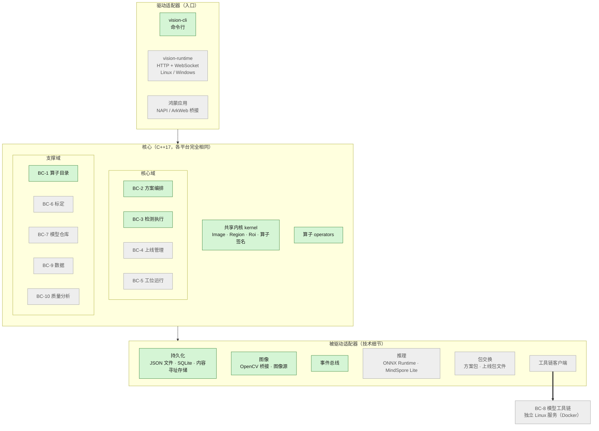
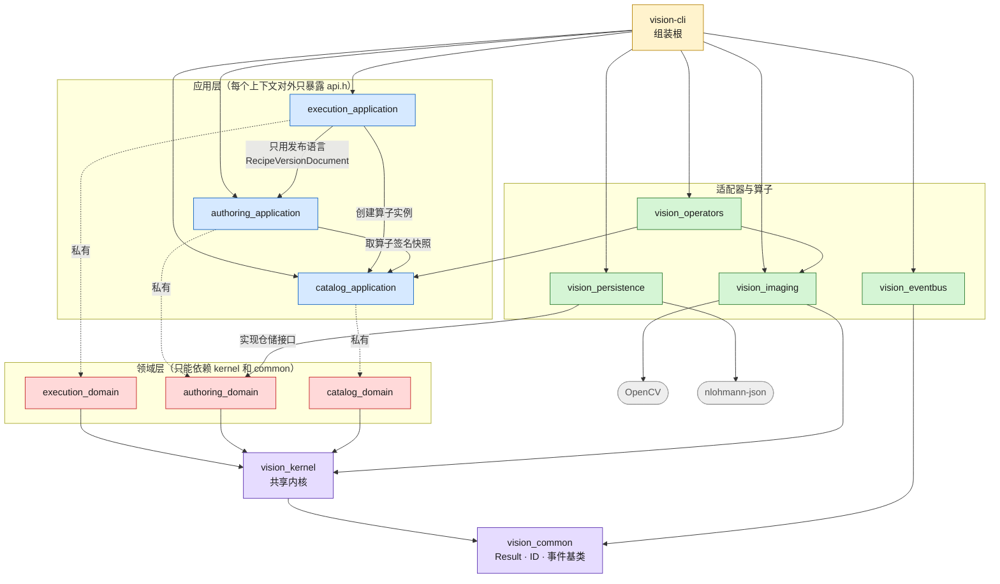
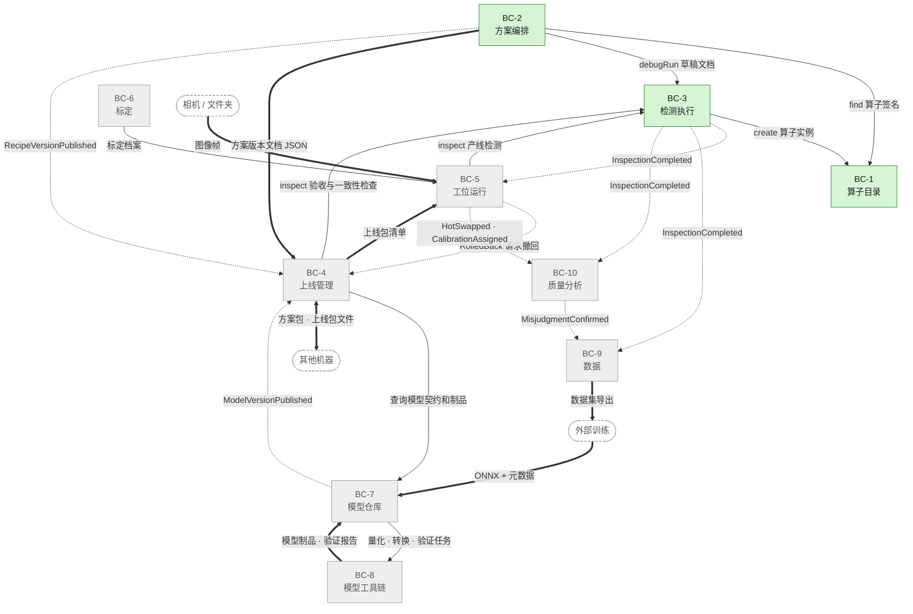
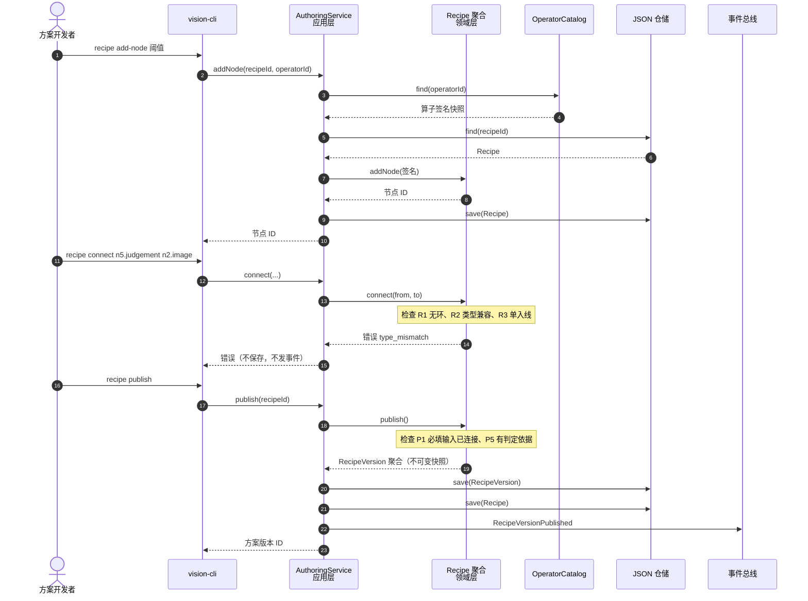
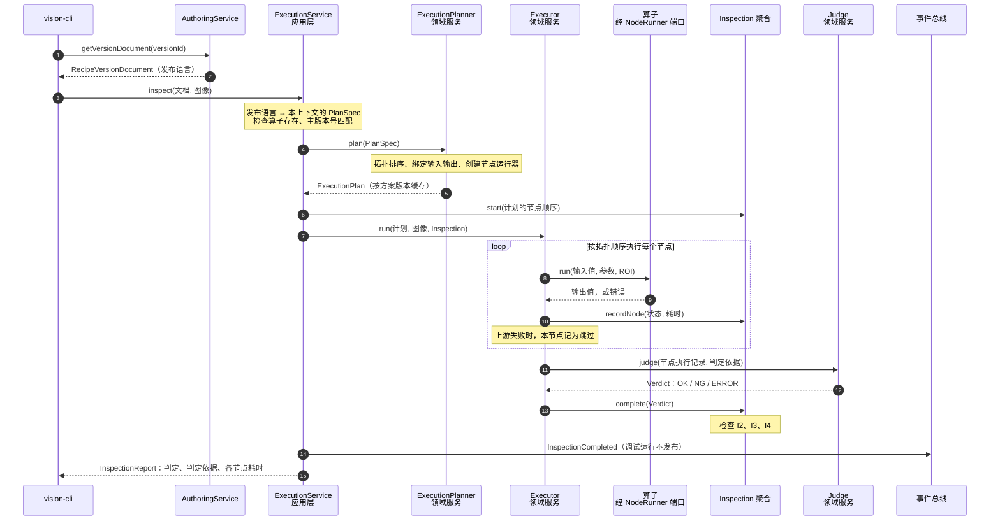
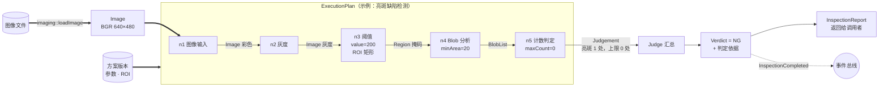
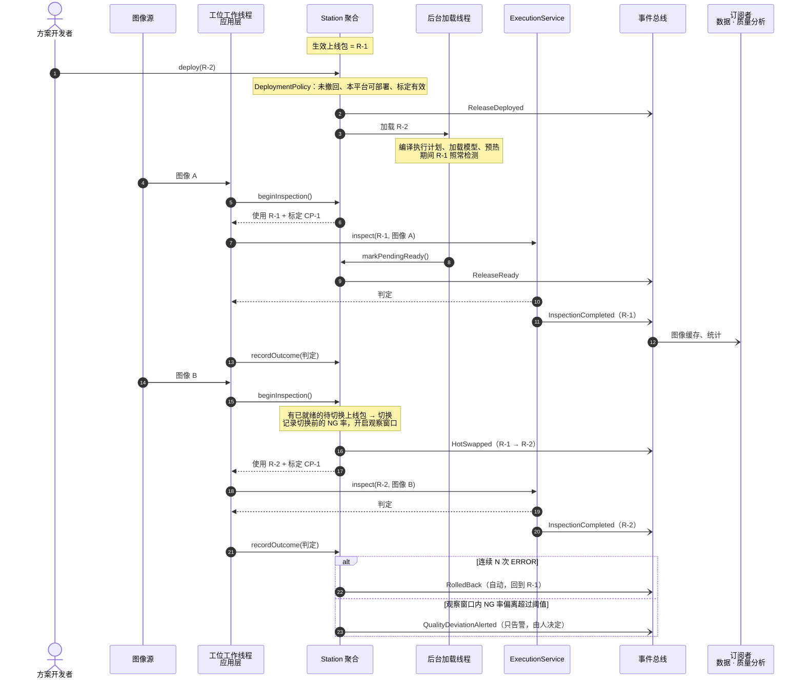
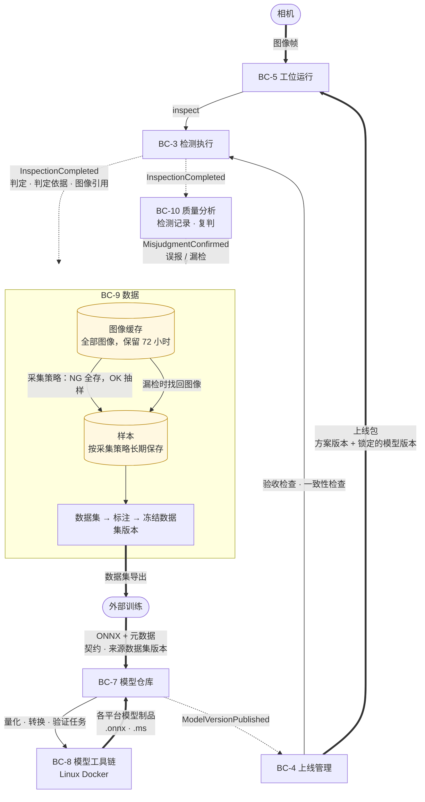

# 07 架构图：模块关系、消息传递、数据流向

| 项 | 内容 |
|---|---|
| 版本 | v0.1 |
| 日期 | 2026-11-12 |
| 依据 | [02-architecture.md](02-architecture.md)、[ddd/04-context-map.md](ddd/04-context-map.md)、[ddd/05-tactical-design.md](ddd/05-tactical-design.md)，以及 POC-1 的实际代码 |

本文档用 8 张图回答三个问题：

| 问题 | 图 |
|---|---|
| 模块之间是什么关系？ | 图 1（总览）、图 2（代码模块依赖） |
| 消息怎么传递？ | 图 3（上下文之间的消息）、图 4（编辑与发布时序）、图 5（一次检测的时序）、图 7（产线热切换时序） |
| 数据怎么流动？ | 图 6（一次检测内部的数据流）、图 8（数据到模型的闭环） |

**图例（全文通用）**

| 画法 | 含义 |
|---|---|
| 实线箭头 `A --> B` | 同步调用：A 调用 B 的公开接口，等待返回 |
| 虚线箭头 `A -.-> B` | 领域事件：A 发布事件，B 订阅；A 不知道 B 的存在 |
| 粗线箭头 `A ==> B` | 发布语言：带版本号的文档或文件（JSON、方案包、上线包文件、模型制品） |
| 绿色 | POC-1 已实现 |
| 灰色 | 已设计，尚未实现 |

---

## 图 1：系统总览

三层结构：驱动适配器（谁来调用）→ 核心（10 个限界上下文中的 9 个）→ 被驱动适配器（核心调用谁）。模型工具链是独立进程。

---

## 图 2：代码模块依赖（POC-1 的实际 CMake 目标）

箭头方向是“依赖”。**点线**表示私有依赖：应用层私有地链接自己的领域层，所以领域层的头文件不会传递给使用者，其他上下文想包含它会编译失败（ADR-17）。

要点：

- **领域层（红色）不依赖 OpenCV**，也不依赖任何适配器。
- **检测执行不认识方案编排的领域类**，只认识它的发布语言 `RecipeVersionDocument`。
- **适配器依赖领域层**（实现领域层定义的接口），而不是反过来。这就是依赖倒置。
- 只有组装根 `vision-cli` 能同时看到所有模块。

---

## 图 3：上下文之间的消息

线上的文字是具体的消息名。三种线型对应三种传递方式（见图例）。

### 领域事件一览

| 事件 | 发布者 | 订阅者及其动作 | 状态 |
|---|---|---|---|
| `RecipeCreated` | BC-2 `Recipe` | 界面刷新 | ✅ 已实现 |
| `RecipeVersionPublished` | BC-2 `Recipe` | BC-4：可以用它创建上线包 | ✅ 已发布，订阅者待实现 |
| `RecipeVersionDeprecated` | BC-2 `RecipeVersion` | BC-4：不能再用它创建上线包 | ✅ 已发布，订阅者待实现 |
| `InspectionCompleted` | BC-3 `Inspection`（调试运行不发布） | BC-5：统计连续 ERROR、NG 率；BC-9：图像缓存、按采集策略存样本；BC-10：检测记录、批次统计 | ✅ 已发布，订阅者待实现 |
| `ModelVersionPublished` | BC-7 | BC-4：提示可以创建新上线包（规则 P9） | 待实现 |
| `ReleaseCreated` / `ReleaseAccepted` / `ReleaseConsistencyPassed` / `ReleaseWithdrawn` | BC-4 `Release` | 界面；BC-5 部署检查时查询状态 | 待实现 |
| `ReleaseDeployed` / `ReleaseReady` / `HotSwapped` / `RolledBack` | BC-5 `Station` | 界面实时刷新；BC-10 在趋势图上标注；`RolledBack` 带撤回请求时 BC-4 撤回上线包 | 待实现 |
| `QualityDeviationAlerted` / `CalibrationExpired` | BC-5 `Station` | 界面告警 | 待实现 |
| `MisjudgmentConfirmed` | BC-10 `Review` | BC-9：样本进入待标注；漏检时从图像缓存找回 | 待实现 |

---

## 图 4：编辑并发布方案的消息时序（POC-1 已实现）

注意：被拒绝的命令直接返回错误，**不产生事件**；编辑草稿也不产生事件，只有“创建”和“发布”会发布事件。

---

## 图 5：一次检测的消息时序（POC-1 已实现）

---

## 图 6：一次检测内部的数据流（示例方案，POC-1 已实现）

线上标注的是端口上流动的**数据类型**。判定依据（`Judgement`）汇总成判定后，随事件流向下游。

---

## 图 7：产线检测与热切换的消息时序（已设计，待实现）

关键点：**切换只发生在 `beginInspection()` 里**。正在进行的检测继续使用旧上线包；每次检测开始时就确定它使用的上线包和标定档案（H-04、S3、S5）。

---

## 图 8：数据到模型的闭环（已设计，待实现）

从产线图像出发，经过复判、标注、外部训练、模型工具链，回到产线。粗线是文件或文档，虚线是领域事件。

可追溯链（NFR-06）：每次**检测** → 上线包 → 方案版本 + 模型版本 → 数据集版本 → 样本 → 产生这个样本的那次检测。

---

## 修订记录

| 版本 | 日期 | 说明 |
|---|---|---|
| v0.1 | 2026-11-12 | 初稿：8 张图，覆盖模块关系、消息传递、数据流向；标注 POC-1 已实现的部分 |
