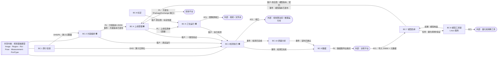

# 04 限界上下文与上下文映射

| 项 | 内容 |
|---|---|
| 版本 | v0.2（D4-1 已决定） |
| 日期 | 2026-11-12 |
| 依据 | [01-event-storming.md](01-event-storming.md)、[02-glossary.md](02-glossary.md)、[03-subdomains.md](03-subdomains.md) |

> **限界上下文不等于微服务。** 除了模型工具链（独立的 Linux 服务），其他上下文都运行在同一个程序里，只是代码模块之间边界清晰、按约定的方式协作。

## 1. 上下文清单

| # | 上下文 | 子域类型 | 职责（一句话） | 核心模型 | 包含的事件（见 01） | 阶段 |
|---|---|---|---|---|---|---|
| BC-1 | **算子目录** | 支撑 | 管理有哪些算子、各自的端口和参数定义 | `OperatorMeta`、`PortType`、`ParamDef` | A1–A5 | MVP |
| BC-2 | **方案编排** | 🟥 核心 | 编辑方案草稿，守护编辑规则，发布方案版本 | `RecipeDraft`、`Node`、`Edge`、`NamedRegion`、`ModelDependency`、`RecipeVersion` | B1–B18、C1–C3、C10 | MVP |
| BC-3 | **检测执行** | 🟥 核心 | 把方案编译成执行计划，对图像执行一次检测，得出检测结果和判定 | `ExecutionPlan`、`Inspection`、`NodeExecution`、`InspectionResult`、`Verdict` | D3–D7 | MVP |
| BC-4 | **上线管理** | 🟥 核心 | 用方案版本和具体模型版本组装上线包，做一致性验证；在平台之间交换方案包 | `Release`、`ConsistencyCheck`、`GoldenSet`、`RecipePackage` | C4–C7、B16–B18（导入导出） | MVP（简化） |
| BC-5 | **工位运行** | 🟥 核心 | 管理工位的生命周期：启动、热启动、部署、热切换、回滚；驱动检测 | `Station`、`activeRelease`、`pendingRelease`、`ImageSource` 绑定 | D0–D2、D10、C8–C9、G1–G8 | MVP（简化） |
| BC-6 | **标定** | 支撑 | 为工位的相机建立像素与毫米的换算关系；标定档案属于工位相机（D4-1） | `CalibrationProfile` | D0a–D0b | P1 |
| BC-7 | **模型仓库** | 支撑 | 管理模型、模型版本、模型契约和各平台的模型制品 | `Model`、`ModelVersion`、`ModelContract`、`ModelArtifact` | F1–F2、F8–F9 | P1 |
| BC-8 | **模型工具链** | 支撑 | 执行量化、转换、验证任务（独立的 Linux 服务） | `ToolchainJob`、`QuantCalibrationSet` | F3–F7 | P1 |
| BC-9 | **数据** | 支撑 | 按采集策略保存样本，管理数据集、数据集版本和标注，导出数据集 | `CapturePolicy`、`Sample`、`Dataset`、`DatasetVersion`、`Annotation` | E1–E8 | P1 |
| BC-10 | **质量分析** | 支撑 | 复判、误报和漏检统计、批次报告、SPC | `Review`、`Batch`、`InspectionRecord`、`MeasurementSeries` | D8–D9 | P1（SPC 为 P2） |

**通用域不是上下文**：视觉算法库、推理运行时、量化和转换工具、图像采集驱动都作为外部系统，通过防腐层（端口和适配器）接入。

## 2. 子域与上下文的对应

| 子域 | 上下文 | 说明 |
|---|---|---|
| 方案编排 | BC-2 | 一一对应 |
| 检测执行 | BC-3 | 一一对应 |
| 上线与热更新 | **BC-4 + BC-5** | 拆成两个：上线包“是什么、可不可用”（BC-4）和工位“正在用哪个、怎么切换”（BC-5）。两者生命周期不同：上线包创建后不再变化，工位的状态每秒都在变 |
| 模型工具链 | **BC-7 + BC-8** | 拆成两个：模型仓库（元数据，在每个平台上都要有）和工具链（重计算，只在 Linux 上运行）。部署位置不同是拆分的主要原因 |
| 数据、标注 | **BC-9** | 合并：标注只做简单部分，和数据集关系紧密，没必要单独成为上下文 |
| 算子目录 | BC-1 | 一一对应 |
| 标定 | BC-6 | 一一对应。标定档案属于工位相机，方案只声明标定需求（D4-1） |
| 结果统计 | BC-10 | 改名为“质量分析”，并纳入复判（见决策点 D4-5） |

## 3. 上下文映射图

### 协作关系说明

| 上游 → 下游 | 模式 | 交换的内容 | 说明 |
|---|---|---|---|
| 共享内核 ↔ BC-1/2/3 | **共享内核** | 视觉基础值对象：`Image`、`Region`、`Roi`、`Pose`、`Measurement`、`PortType` | 三方必须完全一致；**保持很小**，修改需三方一致同意 |
| BC-1 → BC-2 | **开放主机服务 + 发布语言** | 算子元数据列表 | 编排据此生成节点外观、参数面板、校验连线 |
| BC-1 → BC-3 | 开放主机服务 | 根据算子 ID 创建算子实例 | |
| BC-2 → BC-4 | **发布语言** + 领域事件 | 方案版本 JSON（带 `schemaVersion`）；`方案版本已发布` | 编排内部怎么变都不影响下游，只要发布格式不变 |
| BC-2 → BC-3 | 客户-供应商 | 调试运行：草稿编译成执行计划后运行，返回所有节点的中间结果 | BC-3 是**检测引擎**，被三个上下文复用（见 D4-2） |
| BC-4 → BC-3 | 客户-供应商 | 一致性验证：用基准图集运行上线包 | |
| BC-5 → BC-3 | 客户-供应商 | 产线检测 | |
| BC-7 → BC-4 | 客户-供应商 + 领域事件 | 查询模型版本、模型契约、各平台制品是否齐全；`模型版本已发布`（触发规则 P9） | |
| BC-4 → BC-5 | **发布语言** | 上线包清单：方案版本 + 锁定的模型版本 + 制品位置 | 工位只认上线包，不关心它是怎么组装出来的 |
| BC-6 → BC-5 | 客户-供应商 | 工位相机的标定档案 | 见 D4-1 |
| BC-3 → BC-9、BC-10 | **领域事件** | `检测已完成`（带判定、判定依据、结果项、图像引用、上线包） | 检测执行不知道谁在订阅 |
| BC-10 → BC-9 | 领域事件 | `误判已确认`（误报或漏检） | 触发规则 P3：样本进入待标注 |
| BC-7 ↔ BC-8 | 客户-供应商（异步任务） | 量化、转换、验证任务；返回模型制品和验证报告 | BC-8 是独立部署的服务 |
| BC-9 → 外部训练 | 发布语言 | 数据集导出格式 | |
| 外部训练 → BC-7 | **防腐层** | 导入 ONNX 和元数据，翻译成我们的模型契约 | 外部格式的变化不影响模型仓库 |
| BC-8 → 转换工具 | 防腐层 | | MindSpore Lite 等工具的变化只影响适配器 |
| BC-3 → 算法库、推理 | 防腐层（端口） | `IInferBackend` 等 | |
| BC-5 → 图像源 | 防腐层（端口） | `IImageSource` | |
| BC-4 ↔ 其他平台 | 发布语言 | 方案包（`PackageExchange` 端口，先实现文件适配器） | 见 H-06 |

## 4. 同一个词，在不同上下文里的不同模型

| 词 | BC-2 方案编排 | BC-3 检测执行 | BC-4 上线管理 | BC-5 工位运行 | BC-10 质量分析 |
|---|---|---|---|---|---|
| **方案** | `RecipeDraft`：可编辑、带画布布局和撤销历史；`RecipeVersion`：已发布、不可变 | `ExecutionPlan`：已编译、节点已排序、参数已绑定、模型已解析 | 方案版本的 ID 和它声明的模型依赖 | 不直接接触，只看上线包 | 只是一个标签：“方案名@版本” |
| **模型** | `ModelDependency`：模型 ID + 兼容范围 | 已加载的推理会话 | 锁定的模型版本，检查契约是否兼容 | 不直接接触 | — |
| **工位** | — | — | 部署目标 | `Station` 聚合：状态、生效和待切换的上线包、图像源 | 只是一个标签：工位 ID |
| **检测** | 调试运行（不产生正式检测记录） | `Inspection` 聚合：节点执行记录、检测结果、判定 | 一致性验证中的一次运行 | 触发和计数 | `InspectionRecord`：扁平化的记录，用于统计和复判 |
| **图像** | 调试用的样图 | `Image`：像素数据 | 基准图集中的一张 | 图像源送来的一帧 | 检测记录引用的图像 |
| **节点** | 有画布坐标、可编辑参数 | 有执行状态、耗时、输出 | — | — | — |

（BC-7 中的“模型”是完整的生命周期模型：`Model` → `ModelVersion` → `ModelArtifact`；BC-9 中的“图像”是带来源信息和标注的 `Sample`。）

## 5. 🟥 决策点

### 已决定

| # | 问题 | 决定 | 日期 |
|---|---|---|---|
| D4-1 | 标定属于方案，还是属于工位？ | **属于工位上的相机**，每个工位、每个相机单独标定。方案只声明标定需求；部署时工位相机没有有效标定则拒绝；重新标定从下一次检测开始生效，检测记录所用的标定档案 | 2026-11-12 |

### 待确认

| # | 问题 | 选项 | 建议 |
|---|---|---|---|
| D4-2 | **检测执行要不要和工位运行分开？** | A. 合成一个；B. 分开 | **B**。检测引擎被三个上下文复用：编排的调试运行、上线管理的一致性验证、工位的产线检测。合在工位里，另外两个就得依赖工位 |
| D4-3 | **模型仓库和模型工具链要不要分开？** | A. 合成一个；B. 分开 | **B**。部署位置不同：仓库的元数据每个平台都需要；工具链是重计算，只在 Linux 上运行 |
| D4-4 | **方案包的导入导出放在哪？** | A. 上线管理；B. 单独的“交换”上下文 | **A**（暂时）。逻辑不多，以后多机器同步变复杂时再拆出来 |
| D4-5 | **复判放在哪？** | A. 工位运行；B. 质量分析 | **B**。复判是对检测结果质量的事后判断，产出误报和漏检的结论，服务于统计和数据闭环，而不是控制工位 |

## 6. 按阶段的上下文范围

| 阶段 | 上下文 |
|---|---|
| POC / MVP | BC-1、BC-2、BC-3、BC-4（只做上线包和方案包导入导出）、BC-5（只做启动、部署、热切换、回滚） |
| P1 | BC-6、BC-7、BC-8、BC-9、BC-10，以及 BC-4 的一致性验证 |
| P2 | SPC、影子运行、脚本算子 |
