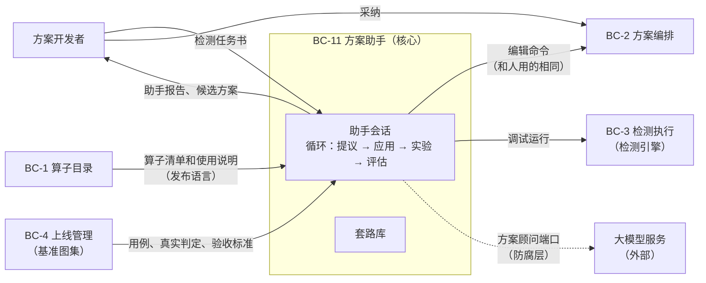
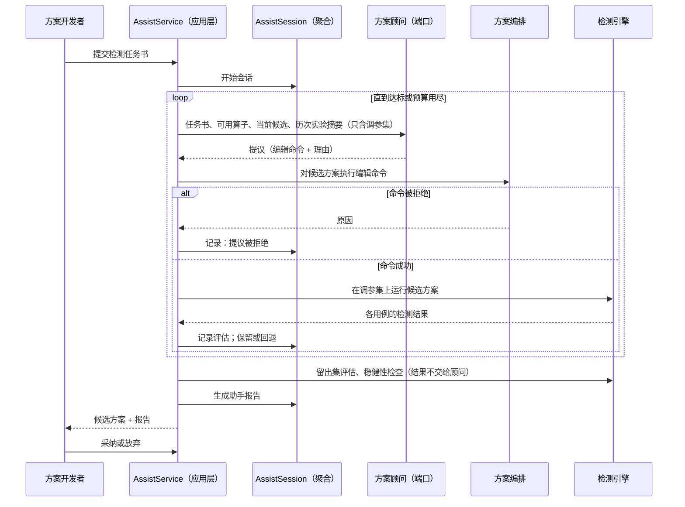

# 07 方案助手（草案）

| 项 | 内容 |
|---|---|
| 版本 | v0.1（初稿，待评审。评审通过后再把内容并入 00～06 各文档） |
| 日期 | 2026-11-13 |
| 起因 | 愿景讨论：拖拽搭建降低的是“写代码”的门槛，没有降低“懂视觉”的门槛。用 Agent 的思路自动搭建、测试、迭代方案，辅助技术人员 |
| 已定 | **大模型在领域层只是一个抽象（端口），具体实现在适配器层，可以扩展**（2026-11-13） |

## 1. 要解决的问题

现有的可视化视觉软件，用户仍然要自己回答三个问题：

| 层次 | 问题 | 需要的经验 |
|---|---|---|
| 选方法 | 这种缺陷该用阈值、Blob、边缘，还是模板匹配？ | 知道每种方法的适用范围 |
| 调参数 | 阈值多少？窗口多大？门限定在哪？ | 知道参数和图像特征的关系 |
| 验证 | 在哪些图上测？光线变了还行不行？误报和漏检各多少？ | 知道方法在什么情况下会失效 |

第三层最容易被忽略。一个在十张图上“看起来没问题”的方案，上了产线之后才发现光线一变就不行，是最常见的失败方式。

**方案助手**：用户给出样本图像和验收标准，助手提出方案、在图像上实际运行、根据结果修改，反复迭代；最后交出一个**人能看懂、能修改、能审核的普通方案**和一份测试报告。

定位是**副驾驶，不是自动驾驶**：

- 助手产出的方案和人手工搭的完全一样，可以在编辑器里打开，逐个节点查看中间结果。
- 助手不能发布。发布仍然由人决定，并且走原有的验收检查。
- 产线运行时里没有助手，也没有大模型。产线上运行的只有已发布的、确定的方案版本。

## 2. 为什么现有的设计适合做这件事

助手需要的“抓手”，前面的设计里已经都有了：

| 助手需要 | 已有的设计 |
|---|---|
| 知道有哪些算子，各自的输入、输出、参数范围 | BC-1 算子目录：`OperatorMeta`、`ParamDef`（类型、上下限、说明） |
| 搭出来的东西必须合法 | BC-2 `Recipe` 聚合的不变量 R1～R6：类型接错、成环、参数越界都会被拒绝，并给出可读的原因 |
| 试运行，看到每一步的结果 | BC-3 调试运行：每个节点的输出、耗时、失败原因 |
| 客观的好坏标准 | BC-4 基准图集：人确认的真实判定 + 用户设定的验收标准（D5-2） |
| 改坏了能退回 | 草稿与版本分离；方案版本不可变 |

所以助手**不需要任何特权**：它通过和人相同的命令编辑草稿，通过相同的检测引擎运行，用相同的标准评估。

## 3. 最重要的一个设计决定：循环是我们的，大模型只负责“提议”

有两种做法：

| | 做法 A：大模型驱动 | 做法 B：我们的循环驱动（**建议**） |
|---|---|---|
| 谁控制流程 | 把一组工具交给大模型，由它决定调用什么、什么时候结束 | 领域层自己实现“提议 → 应用 → 运行 → 评估 → 记录”的循环；每一轮只问大模型一个问题：**下一步建议怎么改？** |
| 大模型的输出 | 直接对系统产生作用 | 只是一份**数据**（提议），由我们的代码检查之后才应用 |
| 可测试 | 难：行为取决于模型 | 容易：换一个按固定脚本回答的假实现，就能测试整个循环 |
| 换模型、离线 | 和具体的模型接口绑定 | 领域层不知道大模型的存在；可以换成云端、局域网、本机的模型，或者不用大模型的规则实现 |
| 预算、审计 | 需要额外约束 | 轮数、时间、每一轮的记录天然由我们掌握 |

做法 B 就是“大模型属于领域层的一个抽象，实现可扩展”的具体含义。领域层把它叫做**方案顾问**（`RecipeAdvisor`）：

```
RecipeAdvisor（端口，定义在 BC-11 的领域层）
  propose(任务书, 可用算子, 当前候选方案, 历次实验的摘要) → 提议 | 建议结束
```

领域层里没有“提示词”“模型名称”“接口地址”这些词。它们全部在适配器里。

| 适配器（可扩展） | 用途 |
|---|---|
| 脚本顾问 | 按预先写好的步骤回答。用于单元测试，以及演示时保证可重复 |
| 套路顾问 | 不用大模型：按任务类型从“套路库”（见第 6 节）里选一个起点，再按固定的规则搜索参数。**断网时可用**，也是比较大模型效果的基线 |
| 云端大模型顾问 | 通过网络调用大模型服务 |
| 局域网大模型顾问 | 工厂内网部署的模型服务 |
| 本机大模型顾问 | 在设备上运行的小模型（远期） |

> 适配器内部可以自由使用大模型的工具调用等能力，只要对外表现为“给出一个提议”。

## 4. 通用语言（新增）

| 术语 | 英文标识 | 含义 | 不要说 |
|---|---|---|---|
| 方案助手 | `RecipeAssistant` | 自动搭建、测试、迭代方案的功能 | AI、机器人 |
| 检测任务书 | `InspectionBrief` | 用户交给助手的输入：要检测什么（文字描述）、基准图集、验收标准、约束（节拍、允许使用的算子、数据外发策略） | 需求、提示词 |
| 助手会话 | `AssistSession` | 助手针对一份任务书的一次完整工作过程，包含所有轮次的记录 | 对话、任务 |
| 方案顾问 | `RecipeAdvisor` | 回答“下一步建议怎么改”的角色。大模型是它的一种实现 | 大模型、AI（在领域层里） |
| 提议 | `Proposal` | 顾问给出的一组对候选方案的修改（编辑命令的序列）和理由 | 回答、输出 |
| 候选方案 | `CandidateDraft` | 会话期间助手正在修改的方案草稿副本。不影响用户自己的草稿，直到被采纳 | |
| 实验 | `Experiment` | 把候选方案在调参集上实际运行一遍 | 测试、试跑 |
| 评估 | `Evaluation` | 一次实验的结果：误报数、漏检数、每张图的判定和判定依据、各节点耗时 | 分数 |
| 调参集 | `tuningCases` | 基准图集中助手可以看到、用来迭代的那部分用例 | 训练集 |
| 留出集 | `holdoutCases` | 基准图集中助手**看不到**的那部分用例，只在会话结束时评估一次，用来检查是不是“对着考卷调参” | 测试集 |
| 稳健性检查 | `RobustnessProbe` | 对图像做已知的扰动（整体变亮或变暗、加噪声、小的平移和旋转）之后重新评估，看结果是否稳定 | 压力测试 |
| 套路 | `Playbook` | 针对一类检测任务的方案骨架和调参建议，例如“亮斑检测：灰度 → 固定阈值 → 开运算 → Blob（面积筛选）→ 计数判定” | 模板（已用于模板匹配） |
| 助手报告 | `AssistReport` | 会话结束时的产出：候选方案在调参集、留出集、稳健性检查上的表现，试过哪些做法，已知的局限 | |
| 采纳 | `adopt` | **人**决定用候选方案替换自己的方案草稿 | 发布（采纳不是发布） |

注意“推理”一词已经被模型推理占用（推理运行时、推理后端），所以大模型这个角色不叫“推理引擎”，叫“顾问”。

## 5. 领域事件

| # | 事件 | 触发者 |
|---|---|---|
| H1 | 助手会话已开始 | 方案开发者（提交任务书） |
| H2 | 提议已提出 | 方案顾问 |
| H3 | 提议已被拒绝（不合法：违反方案的不变量，或使用了不允许的算子） | 系统 |
| H4 | 提议已应用到候选方案 | 系统 |
| H5 | 实验已完成（带评估） | 系统（调用检测引擎） |
| H6 | 候选方案已改进（评估优于此前最好的一次） | 系统 |
| H7 | 候选方案已回退（这一轮没有改进，退回此前最好的状态） | 系统 |
| H8 | 助手会话已结束（原因：达到验收标准 / 预算用尽 / 顾问建议结束 / 用户取消 / 出错） | 系统或方案开发者 |
| H9 | 留出集评估已完成 | 系统 |
| H10 | 稳健性检查已完成 | 系统 |
| H11 | 助手报告已生成 | 系统 |
| H12 | 候选方案已被采纳 | **方案开发者** |
| H13 | 候选方案已被放弃 | 方案开发者 |

🟪 规则：

- 每当**提议已提出** → 先检查，合法才应用；不合法则把拒绝的原因告诉顾问，这一轮计入预算。
- 每当**实验已完成** → 和此前最好的评估比较，决定保留还是回退。
- 每当**助手会话已结束**（无论什么原因）→ 对当时最好的候选方案做留出集评估和稳健性检查，然后生成报告。
- 每当**候选方案已被采纳** → 草稿上记录“来源：助手会话 X”。之后的发布、验收检查和手工搭的方案完全相同。

## 6. 经验放在哪里

“经验”有三个来源，前两个是我们自己的、可以积累和版本化的资产：

| 来源 | 内容 | 位置 |
|---|---|---|
| **算子的使用说明** | 每个算子适合什么情况、什么情况下会失效、参数怎么选。例如阈值算子的大津法：“适合目标和背景各占不小的比例；图像里可能没有目标时不要用” | BC-1 算子目录：在 `OperatorMeta` 里新增面向助手的说明字段 |
| **套路库** | 针对一类任务的方案骨架、参数的起点和搜索范围、应该做哪些稳健性检查 | BC-11 方案助手 |
| 大模型的通用知识 | 图像处理的一般常识 | 外部 |

前两项的内容，和 [OpenCV 教程](../tutorial/opencv/README.md)里“每种方法什么时候失效”的内容是同一批知识：教程是写给人看的，这里是写给助手看的。写教程时积累的认识可以直接沉淀到这里。

有了前两项，“套路顾问”（不用大模型）就能工作。大模型在此基础上提供的是：理解用户用自然语言写的任务描述、在套路之外组合出新的做法、解释为什么这样改。

## 7. 子域与上下文

**子域**：方案助手，🟥 **核心域**（靠它赢）。

**上下文**：新增 **BC-11 方案助手**。不并入 BC-2 方案编排，理由：

- 语言不同：编排里是节点、连线、参数；助手里是任务书、提议、实验、评估、预算。
- 变化的原因不同：助手会随着大模型技术快速变化，方案编排应该保持稳定。
- 方案编排不应该知道助手的存在。助手只是它的又一个使用者。

### 与其他上下文的关系



| 上游 → 下游 | 模式 | 交换的内容 | 说明 |
|---|---|---|---|
| BC-1 → BC-11 | 开放主机服务 + 发布语言 | 算子清单、参数定义、使用说明 | BC-1 需要新增“使用说明”字段 |
| BC-2 → BC-11 | 客户-供应商（BC-11 **遵奉**） | 编辑命令（增删节点、连线、设置参数和 ROI）；命令被拒绝时的原因 | 助手没有专用接口。BC-2 不为助手做任何改动 |
| BC-3 → BC-11 | 客户-供应商 | 调试运行：候选方案 + 图像 → 各节点结果、判定、耗时 | 检测引擎的第四个使用者（前三个：调试、验收、产线） |
| BC-4 → BC-11 | 客户-供应商 | 基准图集的用例、真实判定、验收标准 | 基准图集需要支持划分调参集和留出集（见 D7-3） |
| BC-11 → 大模型 | **防腐层** | `RecipeAdvisor` 端口 | 大模型服务的接口、提示词、模型版本的变化只影响适配器 |
| BC-11 → BC-2 | 领域事件 | `候选方案已被采纳` | 由人触发 |

**BC-11 不依赖**：BC-5 工位运行、BC-7/8 模型、BC-9 数据、BC-10 质量分析。产线一侧完全不知道助手的存在。

## 8. 战术设计（初步）

### 8.1 `AssistSession` 聚合

```
AssistSession（聚合根）
  id
  recipeId                      为哪个方案工作
  brief: InspectionBrief（值对象）
     ├─ goal                    文字描述：要检测什么
     ├─ goldenSetVersion        用哪个基准图集版本
     ├─ holdoutCaseIds          留出集（其余为调参集）
     ├─ allowedOperators        允许使用的算子（默认全部）
     ├─ cycleTimeBudgetMs       单次检测的耗时上限（可选）
     └─ dataSharing             数据外发策略（见 D7-4）
  budget: Budget（值对象）       最多多少轮、最长多少时间
  advisor: AdvisorIdentity       用的是哪个顾问实现及其版本（只作记录）
  rounds: Round（实体）× N
     ├─ proposal                提议：编辑命令的序列 + 理由
     ├─ outcome                 已应用 / 被拒绝（原因）
     ├─ evaluation              这一轮的评估（被拒绝时没有）
     └─ decision                保留 / 回退
  best: 最好的候选方案及其评估
  status                        进行中 / 已结束（原因）/ 已采纳 / 已放弃
  report: AssistReport          结束后生成
```

| 不变量 | 说明 |
|---|---|
| **A1** 会话只能修改候选方案，不能发布，也不能直接修改用户的草稿 | 助手没有任何发布的途径 |
| **A2** 提议只能通过方案聚合的编辑命令应用 | 不合法的提议被拒绝并记录；不存在绕过不变量的后门 |
| **A3** 顾问只能看到调参集 | 留出集的图像、真实判定、评估结果都不会交给顾问 |
| **A4** 评估必须来自检测引擎的实际运行 | 顾问对效果的任何说法都不算数 |
| **A5** 每一轮都留下完整记录 | 提议、理由、是否应用、评估、决定。事后可以逐轮回看 |
| **A6** 超出预算立即结束 | 交出当时最好的候选方案 |
| **A7** 留出集在一次会话中只评估一次 | 评估之后会话不能再继续迭代。想继续，要开新的会话，并且在报告里注明留出集已被用过 |
| **A8** 只有人可以采纳 | 采纳之前，候选方案不影响任何其他东西 |
| **A9** 外发给顾问的内容必须符合任务书的数据外发策略 | 由领域层在调用端口之前检查，而不是依赖适配器自觉 |

### 8.2 领域服务与端口

| 类别 | 名称 | 职责 |
|---|---|---|
| 领域服务 | `Evaluator` | 把一组检测结果和真实判定比较，得出评估（误报、漏检、耗时）；判断是否达到验收标准；比较两次评估哪个更好 |
| 领域服务 | `RobustnessProber` | 按套路里指定的扰动生成变化后的图像，重新评估，给出“结果在多大的扰动范围内保持稳定” |
| 端口 | `RecipeAdvisor` | 给出下一步的提议（**大模型在这里接入**） |
| 端口 | `DraftEditor` | 对候选方案执行编辑命令（由 BC-2 的应用层实现） |
| 端口 | `TrialRunner` | 运行候选方案（由 BC-3 的应用层实现） |
| 端口 | `GoldenCases` | 取用例和真实判定（由 BC-4 实现） |
| 端口 | `ImagePerturber` | 对图像做扰动（需要图像处理，所以是端口，领域层不依赖 OpenCV） |
| 仓储 | `AssistSessionRepository`、`PlaybookRepository` | |

应用层的 `AssistService` 驱动循环：



### 8.3 助手报告里必须有什么

报告是给人做决定用的，所以要诚实：

- 调参集和留出集上的误报、漏检。**两者差别大，就明确提示“可能只是适应了调参集”。**
- 稳健性检查：亮度变化多少、噪声多大、位置偏多少时开始出错。
- 判错的用例：是哪几张图，各个节点的中间结果是什么。
- 试过但放弃的做法及原因。
- 已知的局限。例如“调参集里没有某类缺陷的样本”“留出集只有 5 张，结论不可靠”。
- 用了多少轮、多少时间；用的是哪个顾问。

## 9. 分层

```
core/contexts/assistant/
  domain/         AssistSession、Proposal、Evaluation、Budget、Playbook、
                  Evaluator、RobustnessProber；端口 RecipeAdvisor 等
                  （不依赖 OpenCV，不依赖网络，不知道大模型）
  application/    AssistService：驱动循环，编排对其他上下文的调用
adapters/
  advisor_scripted/     脚本顾问（测试、演示）
  advisor_playbook/     套路顾问（不用大模型）
  advisor_llm_*/        各种大模型顾问（云端、局域网、本机），按需增加
```

按 ADR-17，`assistant_domain` 只能依赖共享内核和 common；它用到的方案编排、检测执行的能力，都通过自己定义的端口获得，由应用层接线。

助手运行在**编辑方案的那台机器上**（开发机，或者鸿蒙电脑上的编辑端）。大模型顾问需要网络；套路顾问不需要。

## 10. 风险

| 风险 | 说明 | 对策 |
|---|---|---|
| 对着考卷调参 | 迭代几十轮，把调参集调到满分，换一批图就不行 | 留出集（A3、A7）；稳健性检查；报告里对比两者 |
| 图像数据外发 | 工厂的产品图像常常是保密的 | 数据外发策略写进任务书，由领域层检查（A9）；默认不外发图像 |
| 依赖外部服务 | 断网、服务变更、费用 | 领域层与大模型解耦；套路顾问作为不联网的实现 |
| 顾问给出看似合理但无效的方案 | 大模型会“自信地犯错” | A4：一切以实际运行的评估为准；报告如实给出留出集表现 |
| 样本太少 | 用户只给了几张图，任何结论都不可靠 | 任务书校验：用例数量、OK/NG 是否都有；报告里明确写出可靠性 |
| 鸿蒙上调用大模型服务 | 未验证 | 新增 POC |
| 范围膨胀 | 这是一块不小的工作 | 不改变 MVP 的顺序；先做不用大模型的最小闭环（见第 11 节） |

## 11. 建议的实施顺序

不影响现有的 MVP 计划（核心骨架、鸿蒙交叉编译等照常进行）。助手本身分三步：

| 步骤 | 内容 | 需要大模型 | 验证什么 |
|---|---|---|---|
| ① | `Evaluator` + 基准图集的最小实现：给一个方案和一组带真实判定的图像，输出误报、漏检 | 否 | 评估本身对不对。这一步对手工搭方案同样有用 |
| ② | `AssistSession` + 循环 + **脚本顾问**和**套路顾问**：在“亮斑检测”这个已有的示例上，从空方案自动搭出一个达标的方案 | 否 | 循环、不变量、留出集、报告。**做法 B 是否走得通** |
| ③ | 大模型顾问：同一个任务换成大模型顾问，和套路顾问对比 | 是 | 大模型到底带来了多少提升；数据外发策略；鸿蒙上的调用 |

第 ② 步完成时就已经有一个可以演示的、不依赖任何外部服务的“自动搭方案”。

## 12. 🟥 决策点

### 已决定

| # | 问题 | 决定 | 日期 |
|---|---|---|---|
| D7-1 | 大模型在架构里的位置 | **领域层只定义抽象（方案顾问端口），具体实现在适配器层，可以扩展** | 2026-11-13 |

### 待确认（下面是建议，请逐条确认或修改）

| # | 问题 | 建议 |
|---|---|---|
| D7-2 | 循环由谁驱动？ | **做法 B**：我们的循环驱动，大模型只负责提议（第 3 节）。这是我对 D7-1 的具体理解，请确认 |
| D7-3 | 留出集怎么划分、存在哪里？ | 由会话的任务书指定（`holdoutCaseIds`），基准图集本身不改。默认按固定的随机种子留出 30%，用户可以手工指定 |
| D7-4 | 默认的数据外发策略 | **默认不外发图像**，只外发在本机算出的统计信息（直方图、Blob 的面积分布、各节点的数值输出）。用户可以改为“外发缩略图”或“外发原图” |
| D7-5 | 助手的自主程度 | 默认**一路做到出报告**，中途不打断；每一轮留记录，用户可以随时取消。可选“每轮确认”模式 |
| D7-6 | 在愿景“靠什么赢”里的位置 | 列为第一条。原来的“低门槛编排”改为它的基础（已按此修改愿景草案，见 00） |
| D7-7 | 套路顾问（不用大模型）要不要做？ | **要**。它是离线可用的保证、测试的基础、衡量大模型价值的基线 |
| D7-8 | 助手能不能使用带模型的算子（异常检测等）？ | 第一阶段不能，只用传统算子。带模型的算子涉及训练，不在助手的范围内 |
| D7-9 | 名称 | “方案助手”。如果比赛宣传需要更响亮的名字，可以另起，但领域语言里保持“方案助手 / 方案顾问” |

### 评审通过后要同步修改的文档

| 文档 | 修改 |
|---|---|
| 00 愿景 | 已改为 v1.2 草案 |
| 01 事件风暴 | 新增 H 组事件和规则 |
| 02 术语表 | 新增第 4 节的术语 |
| 03 子域 | 新增核心域“方案助手” |
| 04 上下文映射 | 新增 BC-11 及其关系 |
| 05 战术设计 | 新增 `AssistSession` 聚合；`OperatorMeta` 新增使用说明 |
| 需求、架构（ADR）、POC 计划、路线图 | 新增相应条目 |
