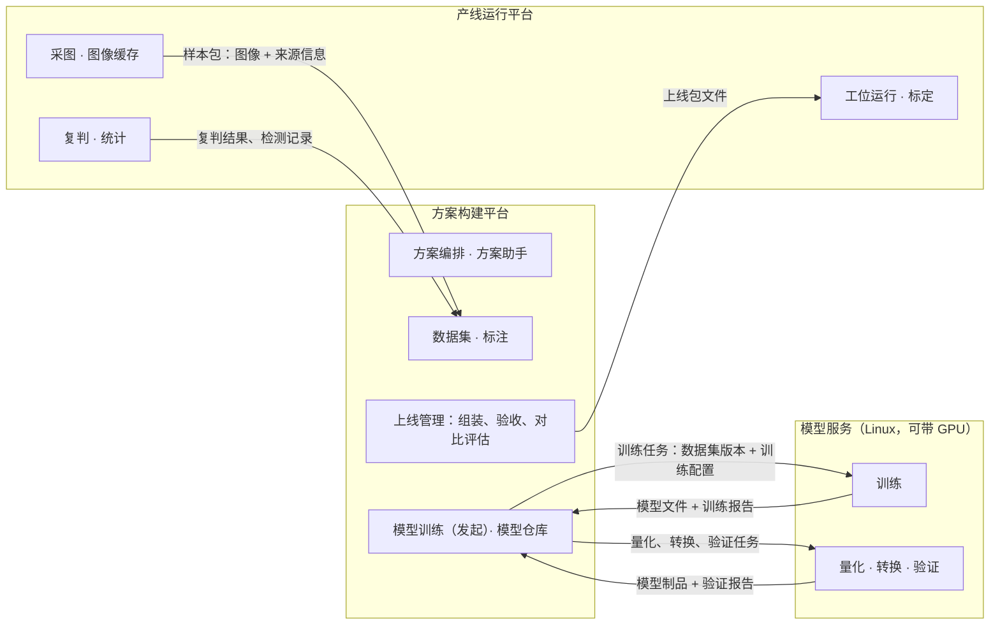
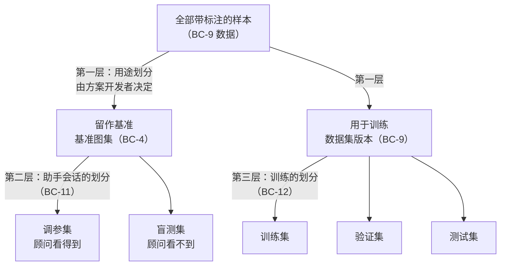

# 08 平台划分、模型训练与数据的划分

| 项 | 内容 |
|---|---|
| 版本 | v1.0（方向已确认；两条实施细节待确认，见第 8 节） |
| 日期 | 2026-11-13 |
| 起因 | 把产品明确分成“方案构建平台”和“产线运行平台”；训练成为方案构建平台可以发起的任务；由此需要理清几套“数据的划分”之间的关系 |

## 1. 两个平台

**平台**是可以单独安装、部署的产品。**限界上下文**是领域模型的边界。这次不重新划分上下文，只决定每个上下文装进哪个平台。同一个上下文可以装进两个平台。

| | 方案构建平台 | 产线运行平台 |
|---|---|---|
| 给谁用 | 方案开发者、算子开发者 | 操作员 |
| 要求 | 灵活；可以联网；可以使用大模型；慢一点没关系 | 稳定；完全离线；行为确定；不停机 |
| 做什么 | 搭方案、方案助手、管理数据集和标注、发起训练、管理模型、组装上线包、验收检查、对比评估 | 运行工位、热启动和热切换、标定、采图、复判、统计 |
| 不包含 | 工位运行 | 方案编排、方案助手、训练、大模型 |

两点说明：

- **两个平台不等于两台机器。** 小的产线可以把两个平台装在同一台鸿蒙电脑上。
- **方案构建平台仍然是跨平台的**，在鸿蒙电脑、Windows、Linux 上都要能用（愿景：方案在任何支持的平台上都能编辑）。

> “产线运行平台”不叫“产线推理平台”：在我们的语言里“推理”专指模型推理，而产线上运行的大部分是传统算子。

### 上下文装进哪个平台

| 上下文 | 方案构建平台 | 产线运行平台 | 说明 |
|---|---|---|---|
| 共享内核 | ✓ | ✓ | |
| BC-1 算子目录 | ✓ | ✓ | 同一批算子 |
| BC-3 检测执行 | ✓ | ✓ | **同一份检测引擎代码**：构建平台上调试、验收、对比评估、助手实验用的引擎，和产线上运行的完全相同。这是“结果一致”的基础 |
| BC-2 方案编排 | ✓ | | |
| BC-11 方案助手 | ✓ | | |
| BC-4 上线管理 | ✓ 组装上线包、基准图集、验收检查、对比评估、导出 | ✓ 导入上线包、在本平台上做一致性检查 | 同一个上下文，两边用到的部分不同 |
| BC-7 模型仓库 | ✓ 导入、发布 | ✓ 只读：按上线包找到本平台的模型制品 | |
| BC-9 数据 | ✓ 数据集、标注、样本用途 | ✓ 采集策略、图像缓存、样本的采集 | 样本在产线上产生，在构建平台上被整理 |
| BC-12 模型训练（新） | ✓ | | 发起和追踪训练任务；训练本身在训练服务里执行 |
| BC-5 工位运行 | | ✓ | |
| BC-6 标定 | | ✓ | 标定档案属于工位相机 |
| BC-10 质量分析 | | ✓ | 复判、批次统计在产线上做 |
| BC-8 模型工具链 | 独立的服务 | | 量化、转换、验证 |

### 两个平台之间怎么交换

只通过文件（或者以后的网络传输，由 `PackageExchange` 端口决定），没有共享的数据库：



| 方向 | 内容 | 状态 |
|---|---|---|
| 构建 → 产线 | 上线包文件 | 已有设计（F-2） |
| 产线 → 构建 | **样本包**：采集的图像、来源信息（工位、检测、判定）、复判结果 | **新增**。数据闭环原来假设两边在同一个程序里，现在需要一种文件格式 |

## 2. 模型训练

### 2.1 范围的变化

| | 之前 | 现在 |
|---|---|---|
| 训练 | 范围外：导出数据集，由外部完成，再导入模型 | **发起和追踪训练任务在范围内**；训练的执行由可替换的“训练后端”完成 |
| 训练算法的研究 | 范围外 | 仍然范围外 |

做法和模型工具链、方案顾问一致：**领域层定义任务和端口，执行是可替换的实现。**

### 2.2 新增上下文：BC-12 模型训练

**子域类型**：🟨 支撑域。闭环需要它，但我们不靠训练算法赢。训练框架和具体的模型算法是 🟩 通用域。

**为什么是独立的上下文**：它有自己的语言（训练集、验证集、测试集、训练配置、训练报告），而方案设计这一侧只关心“交出去一个数据集版本，拿回来一个模型版本”。

| 术语 | 代码名 | 含义 |
|---|---|---|
| 训练任务 | `TrainingJob` | 用一个数据集版本、按一份训练配置训练一个模型的一次执行 |
| 训练配置 | `TrainingConfig` | 训练哪一种模型、关键的设置。⚠️ 不叫“配方”（“配方”是“方案”的禁用近义词） |
| 训练后端 | `TrainingBackend` | 真正执行训练的地方（端口）。可以是我们自己的训练服务，也可以是外部的训练平台 |
| 训练集、验证集、测试集 | `trainSplit`、`valSplit`、`testSplit` | 训练上下文对**一个数据集版本**的内部划分。**这三个词只属于训练上下文** |
| 划分方式 | `SplitSpec` | 三部分的比例和随机种子。记录下来，保证同一个数据集版本、同一个划分方式得到相同的划分 |
| 训练报告 | `TrainingReport` | 训练过程和结果：在验证集、测试集上的模型指标 |

### 2.3 事件

| # | 🟧 事件 | 🟦 命令 | 🟨 执行者 | 备注 |
|---|---|---|---|---|
| T1 | 训练任务已提交 | 提交训练任务 | 方案开发者 | 数据集版本 + 训练配置 + 划分方式 |
| T2 | ❌ 训练任务被拒绝 | 提交训练任务 | 方案开发者 | 数据集版本没有冻结；包含了基准图集的样本（规则 N1）；某一类样本数量不足 |
| T3 | 训练任务已开始 | — | 训练后端 | |
| T4 | 训练任务已完成 | — | 训练后端 | 带模型文件（ONNX）、模型契约、训练报告 |
| T5 | ❌ 训练任务已失败 | — | 训练后端 | |
| T6 | 训练任务已取消 | 取消训练任务 | 方案开发者 | |

🟪 规则：每当**训练任务已完成**，就把模型文件导入模型仓库，成为一个未发布的模型版本，来源记为这次训练任务和它用的数据集版本（→ F1）。之后和手工导入的模型一样，自动进入量化 → 转换 → 验证（已有规则 P4）。

### 2.4 `TrainingJob` 聚合

```
TrainingJob（聚合根）
  id
  datasetVersionId        用哪个数据集版本
  config: TrainingConfig  训练哪一种模型、关键设置
  split: SplitSpec        训练集、验证集、测试集的比例和随机种子
  backend                 交给了哪个训练后端（只作记录）
  status                  已提交 / 进行中 / 已完成 / 已失败 / 已取消
  report: TrainingReport  完成后才有
  output                  模型文件的位置和模型契约，完成后才有
```

| 不变量 | 说明 |
|---|---|
| **T-1** 只能使用已冻结的数据集版本 | 保证可追溯 |
| **T-2** 数据集版本里不能有任何留作基准的样本 | 规则 N1 在提交时再检查一次 |
| **T-3** 划分方式必须记录 | 可重现 |
| **T-4** 已完成的任务不可修改 | 想换设置，就提交新的任务 |
| **T-5** 产出的模型版本必须记录来源 | 训练任务、数据集版本、划分方式 |

**上下文关系**

| 上游 → 下游 | 模式 | 交换的内容 |
|---|---|---|
| BC-9 数据 → BC-12 | 客户-供应商 | 冻结的数据集版本（样本 + 标注） |
| BC-12 → 训练后端 | **防腐层**（`TrainingBackend` 端口） | 训练任务；任务状态；模型文件和训练报告 |
| BC-12 → BC-7 模型仓库 | 领域事件 | `训练任务已完成` → 导入为模型版本 |

原来的“BC-9 → 外部训练平台：导出数据集”“外部训练 → BC-7：导入模型”仍然保留：不想用训练任务时，照样可以手工导出、手工导入。

## 3. 数据的三层划分

引入训练之后，“把数据分成几份”这件事出现在三个地方。它们属于三个不同的上下文，互不相干。



| 层 | 归哪个上下文 | 谁来分 | 分成什么 | 为了什么 |
|---|---|---|---|---|
| 一、用途划分 | BC-9 数据 | 方案开发者 | **留作基准** / **用于训练** | 保证评价方案的图像，模型从来没有见过 |
| 二、助手会话的划分 | BC-11 方案助手 | 任务书（默认自动） | **调参集** / **盲测集** | 防止顾问“对着考卷调参” |
| 三、训练的划分 | BC-12 模型训练 | 训练任务的划分方式 | **训练集** / **验证集** / **测试集** | 训练模型的常规做法 |

对方案设计这一侧来说，只有前两层是它关心的。第三层是训练上下文的内部事务：交出去的是“一个数据集版本”，拿回来的是“一个模型版本”。

### 规则 N1：留作基准的样本永远不用于训练

如果一张图像既训练过模型，又放在基准图集里做验收，模型等于见过答案，验收结果会虚高。这和“对着考卷调参”是同一类问题，只是发生在更上面一层。

| 规则 | 说明 |
|---|---|
| **N1** 一个样本要么留作基准，要么用于训练，不能两者都是 | 严格执行，不是警告 |
| 样本进入已冻结的基准图集 → 用途固定为“留作基准” | 之后不能加入任何数据集 |
| 样本进入已冻结的数据集版本 → 用途固定为“用于训练” | 之后不能加入任何基准图集 |
| 按图像的内容判断“是不是同一个样本” | 同一张图像换个文件名再导入，仍然算同一个 |
| 检查的时机 | 冻结基准图集时；冻结数据集版本时；提交训练任务时（T-2） |

模型落地：BC-9 的 `Sample` 增加**样本用途** `SampleUse`（未分配 / 留作基准 / 用于训练）。基准图集的用例从“引用图像”改为“引用样本”，这样两边指的是同一个东西，才能检查。

### 两种“最终评估”

训练的测试集和基准图集都是“最后考一次”，但不是一回事：

| | 训练的测试集 | 基准图集 |
|---|---|---|
| 评的是 | 模型本身 | 方案加模型，也就是上线包 |
| 指标 | 模型的指标 | 判定对不对：误报、漏检；测量值是否在容差内 |
| 结论用在哪里 | 记入训练报告，作为模型版本的出身信息 | **决定能不能上线** |

能不能上线，只看基准图集上的验收检查。

## 4. 对比评估

**对比评估**（`ComparativeEvaluation`）：把两个上线包（或者两个候选方案）在**同一个基准图集版本**上各运行一遍，对照真实判定，逐项比较谁更好。

用途：换了模型之后比较新旧；助手给出的候选方案和手工搭的方案比较；两种做法比较。

| | 对比评估 | 影子运行（P2，已有设计） |
|---|---|---|
| 在哪里 | 方案构建平台，离线 | 产线运行平台，在线 |
| 用什么图像 | 基准图集（有人确认的真实判定） | 产线上实时的图像（没有真实判定） |
| 能回答 | 谁判得更**对** | 两者的判定有多少**不同** |

“A/B 测试”这个说法不作为领域术语：它既可以指前者也可以指后者，容易混。

对比评估归 BC-4 上线管理。“对照真实判定，算出误报、漏检”这套评估规则只有一份，放在 BC-4，三处共用：验收检查、对比评估、方案助手的实验（BC-11 通过端口使用，不自己另算一套）。

## 5. 对已有设计的改动

| 位置 | 改动 |
|---|---|
| 愿景 | “范围外：模型训练”改为“训练算法的研究”；说明两个平台 |
| BC-9 数据 | `Sample` 新增样本用途；新增样本包（产线 → 构建的文件格式）；规则 N1 |
| BC-4 上线管理 | 基准图集的用例改为引用样本；冻结时检查 N1；新增对比评估；评估规则归这里 |
| BC-11 方案助手 | `Evaluator` 不再是自己的领域服务，改为通过端口使用 BC-4 的评估 |
| BC-7 模型仓库 | 模型版本的来源可以是“训练任务” |
| 架构 | 两个程序（两个组装根）：方案构建平台、产线运行平台；模型服务包含训练和工具链 |

## 6. 风险

| 风险 | 说明 | 对策 |
|---|---|---|
| 相似图像造成的隐性重叠 | N1 只能发现“同一张图像”。同一个零件连拍的几张、同一批次的图像非常相似，一张进训练、一张留作基准，验收同样会虚高 | 应当按零件或批次整体划分，这需要样本带上零件或批次的信息。**现在没有，记为待定问题 Q-09** |
| 训练的范围膨胀 | 训练平台本身可以做得很大 | 第一版只支持一种模型；训练算法不做研究，用现成的 |
| 两个平台的版本不一致 | 构建平台组装的上线包，产线平台的算子版本不匹配 | 已有规则：导入上线包时检查算子的主版本（D5-1） |
| 样本包的体积 | 产线图像很多 | 采集策略已经限制了保存哪些；样本包按批次导出 |
| 鸿蒙上的两个程序 | 一个应用还是两个应用，后台运行的限制 | 待 POC-3b、POC-8 的结论 |

## 7. 分层与代码

```
core/contexts/training/      BC-12：TrainingJob、TrainingConfig、SplitSpec；端口 TrainingBackend
adapters/training_client/    调用训练服务的客户端
apps/studio/                 方案构建平台的组装根：BC-1、2、3、4、7、9、11、12
apps/line/                   产线运行平台的组装根：BC-1、3、4（导入）、5、6、7（只读）、9（采集）、10
services/model-service/      模型服务（Python，Docker）：训练 + 量化、转换、验证
```

两个组装根各自链接自己需要的上下文。`apps/line` 不链接方案编排、方案助手、训练，由构建系统保证（同 ADR-17、ADR-28）。

现有的 `vision-cli` 在划分之前同时具有两边的功能，继续作为开发和测试用的工具保留。

## 8. 🟥 决策点

### 已决定

| # | 问题 | 决定 | 日期 |
|---|---|---|---|
| D8-1 | 是否把产品分成两个平台？ | **分**：方案构建平台、产线运行平台。平台是部署单元，不改变上下文的划分 | 2026-11-13 |
| D8-2 | 训练在不在范围内？ | **发起和追踪训练任务在范围内**；训练是独立的领域（BC-12），执行由可替换的训练后端完成；训练算法的研究不在范围内 | 2026-11-13 |
| D8-3 | 几套“数据的划分”的关系 | **三层**：用途划分（BC-9）、助手会话的划分（BC-11）、训练的划分（BC-12）。第一层由方案构建这一侧决定；第三层是训练上下文的内部事务 | 2026-11-13 |
| D8-4 | 各层的名称 | 留作基准 / 用于训练；**调参集 / 盲测集**；训练集 / 验证集 / 测试集（只属于训练上下文） | 2026-11-13 |
| D8-5 | 基准和训练的数据能不能重叠？ | **不能，严格执行**（规则 N1） | 2026-11-13 |
| D8-6 | 在固定图集上比较两个版本叫什么？ | **对比评估**。“A/B 测试”不作为领域术语 | 2026-11-13 |
| D8-7 | 产线一侧的平台叫什么？ | **产线运行平台** | 2026-11-13 |

### 待确认

| # | 问题 | 建议 |
|---|---|---|
| D8-8 | 训练第一版做到什么程度？ | 建议：做一个**最小的自有训练服务**，只支持一种模型（异常检测），从一个数据集版本一键训练。这样比赛演示时“采图 → 标注 → 训练 → 上线”能完整闭环。工作量比只定义端口大得多，所以请确认 |
| D8-9 | 训练和工具链是不是同一个服务？ | 建议：**部署上合成一个“模型服务”**，领域上仍然是两个上下文（BC-8、BC-12） |
| D8-10 | 相似图像的隐性重叠（Q-09）怎么处理？ | 建议：样本增加“零件编号”或“批次”信息，用途划分按零件或批次整体进行。需要先确认产线上能不能拿到这些信息 |
| D8-11 | 鸿蒙电脑上两个平台是一个应用还是两个应用？ | 等 POC-3b、POC-8 的结论 |
