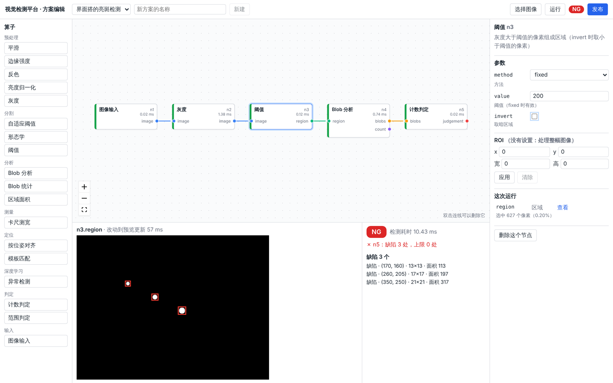
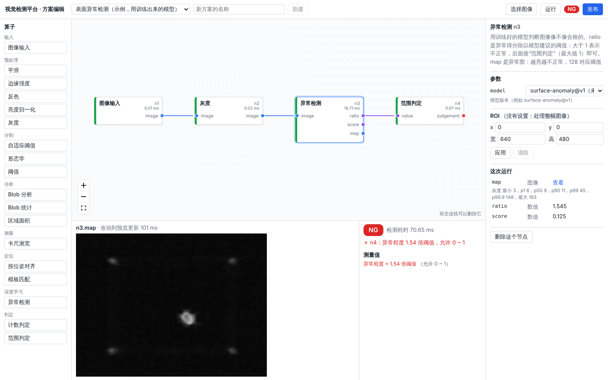

# 界面演示：在浏览器里搭方案

十分钟走一遍：在浏览器里从空白搭出一个检测方案，改参数、看每一步的结果、发布。



> 在 Linux 上验证过（自动的浏览器测试每次构建都会跑）。Windows 上后端由自动构建验证；**界面还没有人在 Windows 上亲手试过**——遇到问题请告诉我。

## 0. 准备（一次）

1. 编译后端：见 [build.md](build.md)
2. 装 Node.js 20 以上（https://nodejs.org ，LTS 版），然后编译界面：

```bash
cd web
npm install
npm run build
```

（国内下载慢：先 `npm config set registry https://registry.npmmirror.com`）

## 1. 启动

在仓库根目录：

```bash
./build/apps/vision-cli --data ./demo-data sample-images ./demo-images
```

```bash
./build/apps/vision-runtime --data ./demo-data
```

第一条生成 4 幅示例图像（2 幅合格、2 幅带亮斑）。第二条启动后端；看到“界面：http://127.0.0.1:8750/”之后，用浏览器打开这个地址。

Windows 上程序是 `build\apps\vision-cli.exe` 和 `build\apps\vision-runtime.exe`。

## 2. 搭一个方案

1. 上面的输入框里填一个名称（比如“亮斑检测”），点**新建**
2. 左边的算子面板里依次点：**图像输入**、**灰度**、**阈值**、**Blob 分析**、**计数判定**。每点一个，画布上多一个节点，自动排在右边
3. 连线：从一个节点右边的圆点拖到下一个节点左边的圆点。**颜色相同的才连得上**（蓝色是图像，绿色是区域，橙色是连通块）：
   - 图像输入 `image` → 灰度 `image`
   - 灰度 `image` → 阈值 `image`
   - 阈值 `region` → Blob 分析 `region`
   - Blob 分析 `blobs` → 计数判定 `blobs`

试一下把“图像输入”的 `image` 拖到“Blob 分析”的 `region` 上：放不下去。类型对不上。

## 3. 运行，看每一步

1. 点右上角的**选择图像**，选 `demo-images/ng_02_three_spots.png`
2. 立刻就运行了：右上角出现判定 **NG**，“缺陷 4 处”。可是这幅图上只有 3 个亮斑——结果是 NG，但原因不对
3. 点画布上的**阈值**节点。下面显示它输出的区域（白的是被选中的像素）：整个浅色的背景都是白的。
   阈值的默认值是 128，背景的灰度大约 150，比它亮，于是背景也被当成了“亮斑”
4. 把右边的 `value` 改成 **200**，按 Tab 或回车。预览马上变了：只剩三个亮斑是白的，判定仍然是 **NG**，但现在是“缺陷 3 处”，
   图上三个红框，右下角列出每个缺陷的位置和大小
5. 再点别的节点看看：**灰度**的输出是灰度图；**Blob 分析**的 `count` 是 3

这就是“调试运行”的用处：只看最后的判定，看不出方案哪里不对；一步一步看中间结果，问题在哪一步一目了然。

每个节点上的小字是它这一次运行花的时间；节点左边的色条：绿色是成功，红色是失败，灰色是因为上游失败而被跳过。

再选一幅合格的图像（`ok_01.png`）：判定变成 **OK**，没有红框。（阈值还是 128 的话，这幅合格的图像也会被判成 NG。）

## 4. 规则在后端

把阈值的 `value` 改成 **999**：上面出现一条红色的提示“参数 value 不能大于 255”，数值没有被改掉。

这句话不是界面写的，是后端的领域层给的——和命令行里 `vision-cli recipe set-param` 报的一字不差。界面自己不判断任何规则。

## 5. 发布

点**发布**：提示“已发布：…@v1”。这个方案版本现在可以做成上线包、部署到工位了（见 [ddd/13-two-programs.md](../ddd/13-two-programs.md)）。

界面和命令行用的是同一个数据目录，所以：

```bash
./build/apps/vision-cli --data ./demo-data recipe list
```

能看到刚才在浏览器里搭的方案。反过来，命令行搭的方案，在界面上面的下拉框里也能打开。

## 6. 带模型的方案

如果做过 [训练闭环演示](training-demo.md)（或者手工导入过模型），在界面里打开那个方案，或者自己搭：
**图像输入 → 灰度 → 异常检测 → 范围判定**（异常检测的 `ratio` 连到范围判定的 `value`；范围判定的 `max` 设成 1）。

点**异常检测**节点：右边的 `model` 是一个下拉框，列出模型仓库里的模型；下面的预览是异常图——越亮的地方越不正常。



## 7. 现在还没有的

- 用鼠标在图像上画 ROI、框匹配模板（ROI 现在是填数字）
- 撤销；改方案的名称；删除方案
- 上线包、工位、训练、方案助手的页面——这些现在只能用命令行
