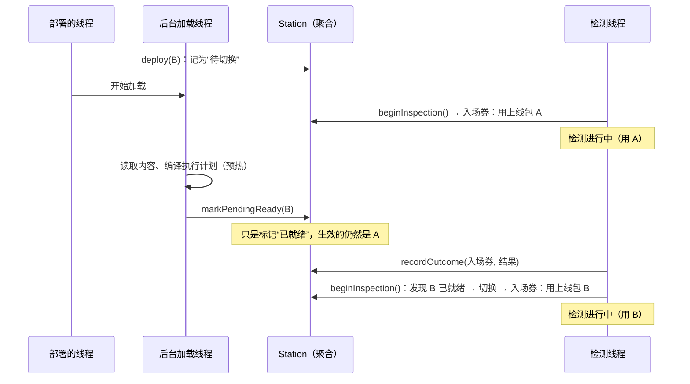

# POC-9 结论报告：热切换

| 项 | 内容 |
|---|---|
| 日期 | 2026-11-20 |
| 验证平台 | Linux（Ubuntu 24.04，GCC 13.3，OpenCV 4.6）；Intel Xeon 2.3 GHz，4 核。**Windows 上的结果以自动构建为准；macOS 和目标设备上没有测过** |
| 验证的假设 | A6：热切换不中断、不丢失检测 |
| 结论 | **✅ 假设成立**。日志保持同步写入，不改为异步（见 §3.3） |

## 1. 通过标准

| 标准（[04-poc-plan](../04-poc-plan.md) §4） | 结果 | 证据 |
|---|---|---|
| 连续检测 10,000 张图，期间 20 次部署和切换、5 次回滚，没有丢失或中断任何检测 | ✅ | 集成测试 `HotSwapUnderLoad_NoInspectionLostOrMixed`：10,000 次检测全部返回结果，序号连续，期间 20 次热切换、5 次回滚。`vision-cli station stress` 在 640×480 和 5MP 图像上各跑 10,000 次，结果相同 |
| 每次检测记录的上线包与“检测开始时生效的上线包”一致（H-04） | ✅ | 同一个测试：两个上线包对同一张图像给出**不同的判定**（一个判 NG，一个判 OK）。逐次核对每次检测的判定和方案版本，都与它入场时拿到的上线包相符，0 次不符。领域层测试 `S5_InFlightInspectionKeepsItsRelease` 单独验证了“检测进行期间新上线包就绪，也不会切换” |
| 测量切换本身的耗时和切换期间的内存峰值 | ✅ | 见 §3.1、§3.2 |
| 测量检测线程里写日志的最坏情况延迟，据此决定日志是否改为异步 | ✅ | 见 §3.3 |

测试汇总：**110 个测试全部通过**，比 POC-1 之后新增 39 个（上线包领域 4、工位领域 24、工位集成 11）。工位和上线包的领域层测试不链接 OpenCV。

并发部分另外用 ThreadSanitizer 跑了三遍工位的集成测试：我们自己的代码里没有数据竞争的报告。有报告的都在 OpenCV 及其线程库内部（系统自带的 OpenCV 没有用检查工具编译，同第 16 课延伸篇里标准库的情况），屏蔽这两个库之后报告数为 0。

## 2. 做了什么

| 部分 | 内容 |
|---|---|
| BC-4 上线管理（最小部分） | `Release` 聚合：创建、撤回（L1、L6）；`ReleaseService`；发布语言“上线包清单” |
| BC-5 工位运行 | `Station` 聚合：部署、就绪、切换、回滚、启动、暂停、停止、自动回滚（S1～S5、P7）；`StationService`：后台加载线程、热启动、驱动检测 |
| BC-3 检测执行 | 新增 `prepare`：提前编译执行计划（预热） |
| 适配器 | 上线包、工位的 JSON 文件仓储 |
| 命令行 | `release create / list / show / withdraw`；`station create / list / show / deploy / rollback / run / stress` |

### 热切换是怎样保证不打断检测的



三点设计：

1. **切换只发生在 `beginInspection()` 里**，也就是两次检测之间（S3）。这是唯一会改变“生效的上线包”的地方（回滚除外）。
2. **入场券**：检测开始时拿到一张入场券，上面写明用哪个上线包，之后整个检测只认这张券（S5）。加载好的上线包用 `shared_ptr` 持有，检测手里有一份，所以即使这期间工位已经换到别的上线包，它用的内容也不会被释放。
3. **慢的事情都不在锁里做**：加载和预热在后台线程；检测本身不持有工位的锁。工位的锁只在读写聚合状态的那一小段时间里持有，所以部署、回滚不用等一次检测结束。

## 3. 测量结果

`vision-cli station stress`，Release 构建。方案是“输入 → 灰度 → 阈值 → Blob → 计数判定”，两个上线包只有判定的上限不同。每组 10,000 次检测，期间 20 次部署、20 次热切换、5 次回滚。

### 3.1 耗时

| | 640×480 | 2592×1944（5MP） |
|---|---|---|
| 单次检测：中位数 / 99% / 最大 | 0.35 / 0.59 / 3.2 毫秒 | 4.4 / 6.0 / 14.2 毫秒 |
| **热切换本身**：中位数 / 最大 | 216 / 596 微秒 | 328 / 527 微秒 |
| 上线包从部署到就绪：中位数 / 最大 | 1.1 / 2.3 毫秒 | 1.5 / 1.8 毫秒 |
| 丢失的检测 / 用错上线包的检测 | 0 / 0 | 0 / 0 |

- **热切换不到 1 毫秒**，远小于一次检测的时间，满足 NFR-04（切换本身小于 1 个检测周期）。
- 这几百微秒几乎全部花在**把工位的新状态写入磁盘**上（切换后要保存，否则重启后恢复不到正确的上线包）。内存里的切换只是换一个指针。在慢的存储设备上这个时间会变长，要在目标设备上再量。
- “部署到就绪”只有 1～2 毫秒，是因为现在的上线包里**没有模型**，加载只是读一个 JSON 文件和编译执行计划。有了模型之后会是几百毫秒到几秒，那正是需要后台加载的原因。这个数字现在没有参考价值。
- 5MP 那一组的判定全部是 OK：示例方案的 ROI 是按 640×480 的像素坐标写的，放到 5MP 图像上只覆盖了左上角一小块。这就是 [POC-1 报告](poc-1-report.md) §6 提出的“ROI 和分辨率绑定”的问题，还没有解决。它不影响这里对耗时和正确性的测量。

### 3.2 内存

| | 640×480 | 5MP |
|---|---|---|
| 开始时 | 57.2 MB | 133.0 MB |
| 过程中最高 | 57.4 MB | 152.5 MB |
| 结束时 | 57.4 MB | 152.5 MB |

5MP 时涨了约 20 MB 之后就不再变化。为了确认不是泄漏，分别跑了 2,000 次和 30,000 次：最高值都是 152.4 MB 左右。这 20 MB 是各个节点的中间图像达到稳定状态后占用的内存。

没有观察到“切换期间的内存峰值”：两个上线包的内容都很小。等上线包里有了模型，切换时新旧两个模型会同时在内存里，那时才有真正的峰值，需要重新测量。

### 3.3 日志：保持同步写入

在检测线程里每次检测写一条日志（同步写文件、每条立即刷新），10,000 个样本：

| | 640×480 | 5MP |
|---|---|---|
| 中位数 | 6.3 微秒 | 8.9 微秒 |
| 99% 不超过 | 24.6 微秒 | 46.0 微秒 |
| 最大 | 73.5 微秒 | 125.8 微秒 |

最坏情况约 0.13 毫秒，是一次 5MP 检测耗时的 3%。**结论：日志不需要改成异步**，保持 ADR-24 的做法。

这个结论的适用范围要说清楚：这是在一台用固态存储的机器上测的。边缘设备如果用 SD 卡或 eMMC，写入的最坏情况可能差一到两个数量级。到了目标设备上要用同一个命令重新测量；如果那时最坏情况超过 1 毫秒，再考虑异步。

## 4. 实现时确定的细节

设计文档没有写到、实现时必须做出决定的地方。**请评审**，不同意的可以改：

| # | 问题 | 现在的做法 | 理由 |
|---|---|---|---|
| 1 | 回滚时，如果还有一个待切换的上线包，怎么办？ | **一并丢弃** | 回滚表示“回到之前验证过的状态”。留着它的话，下一次检测就会立刻切换过去，回滚等于没有做 |
| 2 | 连续 ERROR 达到上限，但没有可以回滚到的上线包（工位只用过一个上线包） | 工位进入**故障**状态，停止检测，等人处理 | 继续检测只会不断产生 ERROR。重新部署一个上线包之后可以再启动 |
| 3 | 检测进行期间发生了手动回滚，这次检测的 ERROR 算不算数？ | **不算**到新的上线包头上 | 它用的是已经被换掉的上线包 |
| 4 | 工位没有在运行时部署的上线包什么时候生效？ | **启动时**直接生效 | 没有“正在进行的检测”，不存在打断的问题 |
| 5 | 程序重启后，上次“已就绪但还没切换”的上线包 | 重新在后台加载，就绪后照常在下一次检测前切换 | 加载好的内容随旧进程消失了 |
| 6 | 自动回滚要不要同时撤回出问题的上线包？ | **不撤回** | 撤回是不可逆的，应该由人决定。手动回滚可以选择同时撤回 |
| 7 | 每次检测都保存工位吗？ | 只在需要持久化的状态变化时保存 | 普通的一次检测只让序号加一，为此写一次磁盘不值得。序号在下次保存时一起写 |
| 8 | “记录检测结果”由谁触发？ | 应用服务在检测结束后直接调用 | 设计里写的是由 `检测已完成` 事件的处理器调用。直接调用更简单，而且不需要从事件反查它属于哪个工位。仍然是每一步只修改一个聚合 |

## 5. 没有做的

| 内容 | 说明 |
|---|---|
| 验收检查、跨平台一致性检查（L4、L5） | 现在“可部署”只等于“没有被撤回”。需要先有基准图集 |
| 模型（L2） | 上线包里的“锁定的模型”字段有了，但还没有模型仓库和推理后端 |
| 相机、标定档案（S5 的后半句） | `Station` 里还没有相机 |
| 质量偏离监控（S6、F-4） | |
| 图像源端口 | `station run` 直接读取文件夹里的图像，还没有把“图像源”抽象成端口 |
| 上线包文件（F-2） | 两个平台之间用文件传递上线包，还没有做 |
| 两个平台分开 | 上线管理和工位运行现在都在 `vision-cli` 里。`ReleaseService` 已经通过端口取得方案版本，不直接依赖方案编排的服务，为分开做了准备 |
| 执行计划的缓存没有清理 | 用过的方案版本的执行计划一直留在内存里。上线包很多、长时间运行时需要处理 |

## 6. 怎样重现

```bash
cmake --preset default
```

```bash
cmake --build --preset default
```

```bash
ctest --preset default -R "Station|Release"
```

测量（需要 Release 构建才有参考价值；下面的各个 ID 换成命令实际输出的值）：

```bash
vision-cli sample-images images
```

```bash
vision-cli recipe build samples/recipes/bright-spot.draft.json
```

```bash
vision-cli recipe publish <方案ID>
```

```bash
vision-cli release create <方案版本ID>
```

再建一个参数不同的方案（`recipe set-param <方案ID> n5 maxCount 5`），同样发布、创建上线包。然后：

```bash
vision-cli station create 工位一
```

```bash
vision-cli station stress <工位ID> <上线包A> <上线包B> images --count 10000 --deploys 20 --rollbacks 5
```
