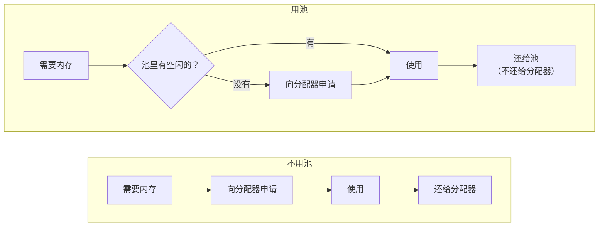
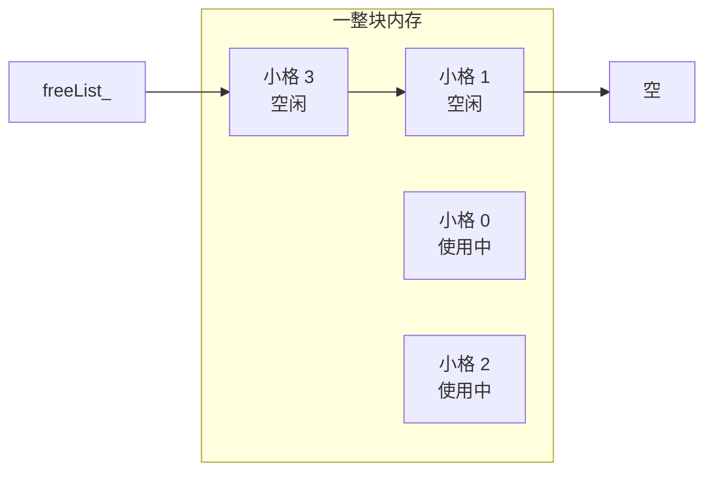
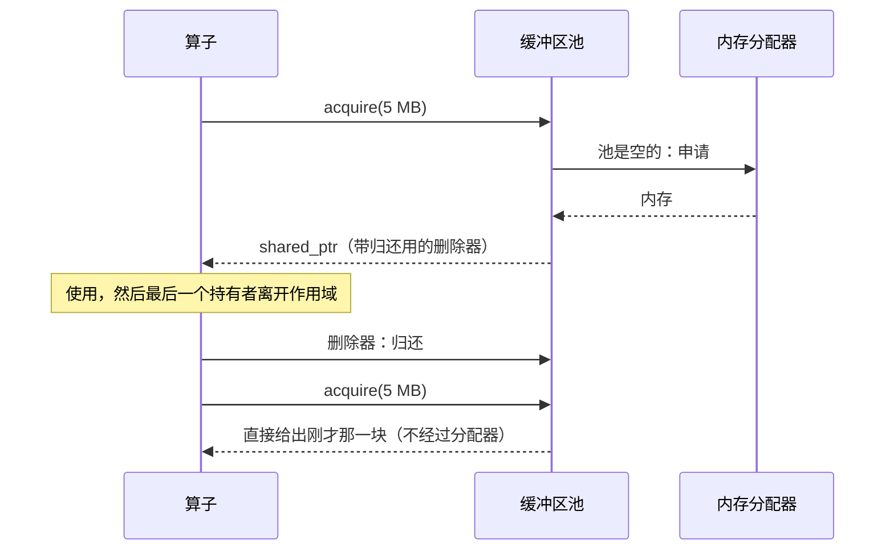
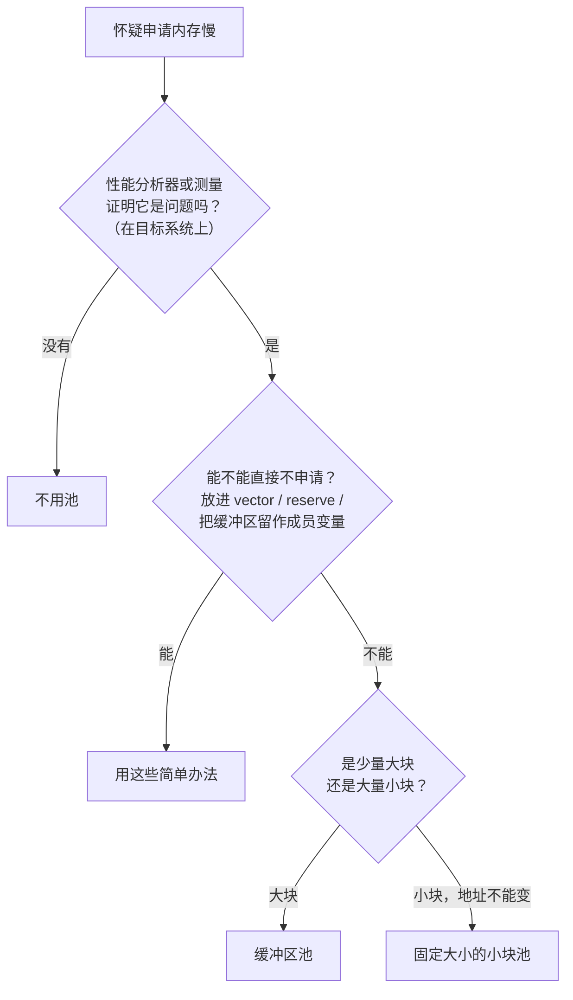

# 第 14 课（延伸）：内存池与缓冲区复用

> 预计用时：2 小时
> 示例代码：[`examples/lesson14a/`](examples/lesson14a/)
>
> 这是第 14 课的延伸。需要先学过第 4 课（RAII 与智能指针）、第 13 课（内存分析）和第 14 课（性能分析）。第 6 节里有一把互斥锁，没学过第 15 课的话，先把它当成“保证同一时刻只有一个线程在改池”就可以。

## 这一课要回答的问题

一次检测里，每个算子都要输出一张图像，每张 5MP 的灰度图约 5 MB。产线上每秒做好几次检测，就是每秒申请、释放几十 MB 的内存。

1. 申请内存到底要花多少时间？
2. 内存池是什么，怎么实现？
3. 它在什么情况下有用，什么情况下没用？
4. 用了之后会带来哪些新问题？

先说结论：**内存池是一种要靠测量来决定用不用的优化。很多时候不需要它，而且它是有代价的。** 这一课的三个示例，在不同的系统上测出来的结论差别很大，这本身就是这一课最重要的内容。

## 1. 申请内存时发生了什么

`new`、`malloc`、`std::vector` 申请内存，背后都是同一个东西在工作：**内存分配器**。它是 C/C++ 运行库的一部分，随编译器或系统提供。

分配器的工作分两层：


- **分配器手里有现成的内存**：它只需要在自己的记录里找到一块合适的，记下“这块已经给出去了”，返回地址。这一步完全在你的进程内完成，很快。
- **分配器手里不够**：它要向操作系统申请。这是一次系统调用（第 15 课预备篇会讲），要慢得多。而且操作系统给的内存页，在第一次被写入时才真正分配物理内存，并且为了安全要先把整页清零（否则你能读到别的程序留下的数据）。每页 4 KB，一张 5 MB 的图像就是 1200 多页，每一页第一次被写入时都要进一次操作系统。

所以申请内存的开销，取决于两件事：

1. 这块内存有多大；
2. 分配器这一次是“给现成的”，还是“向操作系统要”。

第 2 点是分配器自己决定的，不同系统的分配器策略不同。这就是后面测量结果差别很大的原因。

## 2. 测一下

[`examples/lesson14a/alloc_cost.cpp`](examples/lesson14a/alloc_cost.cpp) 测量了两种情况。下面的数字来自两台机器：Windows（MSVC）是项目自动构建用的机器，Linux（GCC）是一台 4 核的开发用机器。你的机器上数字会不同，自己运行一遍。

### 2.1 小块：64 字节

每次申请 1000 个 64 字节的小块，再全部释放。平均每次“申请加释放”：

| | Linux | Windows |
|---|---|---|
| 64 字节的申请加释放 | 约 11 纳秒 | 约 47 纳秒 |

几十纳秒。一次检测如果有 1000 次这样的小块申请，总共是几十微秒，而一次检测是几十毫秒：占千分之一。

**结论：小块内存的申请已经很快了。** 现代的分配器内部对小块本来就是按“池”的方式管理的。除非性能分析器（第 14 课）明确显示 `malloc` 是热点，否则不需要为小块操心。

### 2.2 大块：一张 5MP 图像

三种做法，每种都把整张图写一遍（模拟算子输出结果），重复 300 次：

```cpp
// 做法一：每次申请新的，用完释放
std::unique_ptr<std::uint8_t[]> buffer(new std::uint8_t[imageBytes]);
std::memset(buffer.get(), 128, imageBytes);

// 做法二：每次新建一个 std::vector（vector 会先把每个字节清零）
std::vector<std::uint8_t> buffer(imageBytes);
std::memset(buffer.data(), 128, imageBytes);

// 做法三：只申请一次，反复使用
std::memset(reused.data(), 128, imageBytes);
```

Windows 上的结果（单位：微秒）：

| 做法 | 中位数 | 99% 的情况不超过 | 最慢的一次 |
|---|---|---|---|
| 每次申请新的 | 759 | 964 | 1053 |
| 每次新建 `std::vector` | 867 | 1098 | 1132 |
| 复用同一个缓冲区 | **65** | 79 | 115 |

**复用比每次申请快 11 倍以上。** 写一遍 5 MB 只要 65 微秒，另外的 700 微秒全花在“申请和释放”上。

Linux 上的结果：

| 做法 | 中位数 | 99% 的情况不超过 | 最慢的一次 |
|---|---|---|---|
| 每次申请新的 | 188 | 600 | **2462** |
| 每次新建 `std::vector` | 182 | 215 | 226 |
| 复用同一个缓冲区 | 182 | 220 | 289 |

**中位数几乎没有差别。** 同一份代码，换一个系统，结论完全不同。

### 2.3 为什么差别这么大

因为两个系统的分配器，对“大块内存”的策略不同：

- **Windows 的分配器**：这么大的块，它每次都直接向操作系统申请，释放时立刻还给操作系统。所以每一次都要走第 1 节里说的慢路径：系统调用，加上 1200 多页逐页分配、清零。
- **Linux 的分配器（glibc）**：第一次也是向操作系统要的。但是它发现你释放了一块这么大的内存之后，会调整策略：以后这个大小的块释放时先留在自己手里，下次直接给你。等于**分配器自己替你做了复用**。

注意 Linux 那一行“最慢的一次”：2462 微秒，是中位数的 13 倍。分配器偶尔还是会把内存还给操作系统，再重新要回来，那一次就很慢。后面第 7 节会回到这个数字。

> 上面是这两个系统默认分配器在我们测试的版本上的行为。分配器的策略会随版本变化，也可以被换掉。所以不要背结论，要会测量。

还有一处细节。做法二的 `std::vector<std::uint8_t> buffer(imageBytes)` 按语言规则要把每个字节清零，然后我们又写了一遍，整张图写了两次。Windows 上它确实比做法一慢了约 100 微秒；Linux 上没有变慢，因为 GCC 看出清零之后马上被覆盖，把清零省掉了。这种优化不是每个编译器、每种写法都会做。

### 2.4 鸿蒙上呢

**还不知道。** 鸿蒙用的是另一套运行库，分配器又不一样。我们没有在鸿蒙上测过，也没有在 macOS 上测过。

这是这一节真正要记住的：**分配大块内存的开销，必须在实际要运行的系统上测量。** 在开发机上测出来“没区别”，不代表在部署的机器上也没区别。项目的部署目标是鸿蒙电脑，这一项要到鸿蒙交叉编译跑通之后（POC-3a）在真机上测。

## 3. 内存池的思路

如果测量表明申请内存确实是问题，办法是：**不要每次都找分配器要，自己留着用过的内存，下次接着用。** 这就是内存池。



你其实已经见过“池”了：第 16 课延伸篇的线程池，是把创建代价高的**线程**留着反复用；内存池是把**内存**留着反复用。思路一样。

常见的有两种，针对的问题不同：

| | 固定大小的小块池 | 缓冲区池 |
|---|---|---|
| 管理什么 | 大量大小相同的小对象 | 少量大块内存（图像） |
| 省下的是什么 | 分配器查找、记录的时间 | 向操作系统要内存、清零的时间 |
| 本课示例 | `block_pool.cpp` | `buffer_pool.cpp` |

## 4. 固定大小的小块池

### 4.1 思路：空闲链表

一次申请一整块内存，切成大小相等的小格。需要记住“哪些小格是空闲的”，办法很巧妙：**空闲的小格里反正没有数据，就借用它自己的前 8 个字节，存“下一个空闲小格的地址”。** 所有空闲小格串成一条链表，不需要任何额外的内存。



- **取一个**：把链表的第一个小格摘下来。
- **还一个**：把它挂回链表的最前面。

两个操作都只是改一两个指针，不需要查找。这是蓝桥杯里“数组模拟链表”的同一个想法。

### 4.2 实现

完整代码在 [`examples/lesson14a/block_pool.cpp`](examples/lesson14a/block_pool.cpp)，核心只有这些：

```cpp
class FixedBlockPool {
public:
    FixedBlockPool(std::size_t blockSize, std::size_t blockCount)
        : blockSize_(std::max(roundUp(blockSize), sizeof(FreeNode))),
          blockCount_(blockCount),
          memory_(new std::byte[blockSize_ * blockCount]) {
        // 把整块内存切成小格，全部串到空闲链表上
        for (std::size_t i = 0; i < blockCount; ++i) {
            auto* node = reinterpret_cast<FreeNode*>(memory_.get() + i * blockSize_);
            node->next = freeList_;
            freeList_ = node;
        }
    }

    void* allocate() {                       // 取：摘下链表头
        if (freeList_ == nullptr) return nullptr;
        FreeNode* node = freeList_;
        freeList_ = node->next;
        return node;
    }

    void deallocate(void* block) {           // 还：挂回链表头
        auto* node = static_cast<FreeNode*>(block);
        node->next = freeList_;
        freeList_ = node;
    }

private:
    struct FreeNode { FreeNode* next; };
    std::size_t blockSize_;
    std::size_t blockCount_;
    std::unique_ptr<std::byte[]> memory_;    // 整块内存，池销毁时自动释放（RAII）
    FreeNode* freeList_ = nullptr;
};
```

（上面省略了统计用的计数器。）

池给出来的只是一块**原始内存**，上面还没有对象。使用时要多两步：

```cpp
void* memory = pool.allocate();
Blob* blob = new (memory) Blob{...};   // “定位 new”：在指定的内存上构造对象，不申请内存
// ... 使用 blob ...
blob->~Blob();                          // 手动调用析构函数
pool.deallocate(blob);                  // 把内存还给池
```

平时写的 `new Blob{...}` 其实做了两件事：申请内存、构造对象；`delete` 也是两件事：析构对象、释放内存。用了池，这两件事就要分开来做。**这段代码很容易写错**：忘了析构、忘了归还、归还两次，都不会有编译错误。

### 4.3 测量，以及一个更重要的对比

创建并销毁 10 万个 40 字节的对象，平均每个：

| 做法 | Linux | Windows |
|---|---|---|
| 每个单独 `new` / `delete` | 15.8 纳秒 | 66.9 纳秒 |
| 从固定大小的池里取 | 4.1 纳秒 | 3.6 纳秒 |
| **直接放进 `std::vector<Blob>`** | 8.3 纳秒 | 12.1 纳秒 |

池确实快，Windows 上快了十几倍。但请看第三行：**根本不单独申请，把对象直接放进 `vector`**，速度和池是一个量级的，而代码是这样的：

```cpp
std::vector<Blob> all;
all.reserve(count);
for (...) all.push_back(Blob{...});
```

没有定位 `new`，没有手动析构，没有归还，不可能写错。而且对象在内存里是挨着的，之后遍历它们也更快（第 14 课讲过缓存）。

**所以在动手写小块池之前，先问一句：这些对象真的需要一个一个单独申请吗？** 大多数时候不需要，放进 `vector` 就解决了。项目里连通块的结果就是一个 `std::vector`。

真正需要小块池的情况比较少：对象数量很大、创建和销毁的顺序没有规律、而且每个对象的地址不能变（比如别处保存着指向它的指针，所以不能放在会搬家的 `vector` 里）。典型的例子是链表、树的节点。

## 5. 图像缓冲区池

对我们的项目更有意义的是这一种：管理的是少量的大块内存。

### 5.1 需求

- `acquire(size)`：取一个至少 `size` 字节的缓冲区；池里有空闲的就复用，没有才新建。
- **用完自动归还**。不能指望每个算子的作者都记得调用“归还”。第 4 课的原则：需要成对出现的操作，交给 RAII。
- 池的大小有上限，不能无限增长。
- 多个线程可以同时使用。

### 5.2 关键：自定义删除器

第 4 课讲过，`shared_ptr` 的引用计数归零时会 `delete` 它管理的对象。其实“归零时做什么”是可以自己指定的，这叫**自定义删除器**。我们让它不释放内存，而是把缓冲区还给池：

```cpp
std::shared_ptr<Buffer> acquire(std::size_t size) {
    std::unique_ptr<Buffer> buffer;
    {
        std::lock_guard<std::mutex> lock(state_->mutex);
        // 找一个容量够用的空闲缓冲区
        auto it = std::find_if(state_->idle.begin(), state_->idle.end(),
                               [size](const std::unique_ptr<Buffer>& b) { return b->capacity() >= size; });
        if (it != state_->idle.end()) {
            buffer = std::move(*it);
            state_->idle.erase(it);
        }
    }
    if (!buffer) buffer = std::make_unique<Buffer>();
    buffer->resize(size);  // 容量够时不会重新申请内存

    std::weak_ptr<State> weak = state_;
    return std::shared_ptr<Buffer>(buffer.release(), [weak](Buffer* raw) {   // ← 自定义删除器
        std::unique_ptr<Buffer> returned(raw);
        if (const auto state = weak.lock()) {            // 池还在：还回去
            std::lock_guard<std::mutex> lock(state->mutex);
            if (state->idle.size() < state->maxIdle) state->idle.push_back(std::move(returned));
        }
        // 池已经不在了，或者池已经满了：returned 在这里析构，内存被释放
    });
}
```

（省略了计数器，完整代码见 [`examples/lesson14a/buffer_pool.cpp`](examples/lesson14a/buffer_pool.cpp)。）

使用的人完全感觉不到池的存在：

```cpp
{
    auto out = pool.acquire(imageBytes);
    // ... 往 out 里写结果，可以把 out 复制给别人 ...
}   // 最后一个持有者离开作用域 → 删除器被调用 → 缓冲区自动回到池里
```



### 5.3 这段代码里的四个设计决定

每一个都对应着一个不这样做就会出的问题。

**① 池的状态放在 `shared_ptr<State>` 里，删除器只持有 `weak_ptr`。**

如果删除器直接保存池的指针或引用：池先被销毁，之后才有缓冲区归还，删除器就会访问一个已经不存在的对象（第 13 课的“释放后使用”）。这种情况很容易出现，比如检测结果里的图像被界面多留了一会儿，而工位已经停止、池已经销毁。

用 `weak_ptr`（第 4 课）：归还时先 `lock()` 问一句“池还在吗”，不在了就直接释放内存。示例的第 3 组测试专门验证了这一点。

**② `maxIdle`：池里最多保留几个空闲缓冲区。**

没有上限的池，只会变大不会变小。某一次检测临时多用了 20 个缓冲区，这 100 MB 就永远留在池里了。这正是第 13 课第 5 节说的“没有泄漏，内存却一直涨”，而且 AddressSanitizer 不会报告，因为这些内存确实都还被池持有着。

**③ 加锁，但锁的范围很小。**

查找、取出、放回要加锁（多个线程可能同时来取）。但是“真正申请内存”（`make_unique`、`resize`）放在锁的外面：那是慢操作，不应该让其他线程等着。这是第 15 课“锁里只做必须做的事”的原则。

**④ `acquire` 找的是“容量够用”的，不要求大小正好。**

产线上图像尺寸基本固定，这样足够了。如果尺寸种类很多，小请求可能拿走大缓冲区，造成浪费，那时需要按大小分组。先不做，等真的遇到再说。

## 6. 池带来的新问题

池不是白来的。用了之后，下面这些问题是原来没有的：

| 问题 | 说明 | 对策 |
|---|---|---|
| **拿到的是旧数据** | 复用的缓冲区里是上一次使用留下的内容，不是 0。算子如果只写了图像的一部分，剩下的就是上一张图的残留，结果时对时错，很难查 | 算子必须写满整个输出；或者取出时清零（要花时间，Windows 上约 65 微秒一张） |
| **内存只涨不降** | 见上面 ② | 设上限；记录池的大小，写进日志 |
| **池比缓冲区先销毁** | 见上面 ① | `weak_ptr` |
| **线程安全** | 池是共享的可变数据 | 加锁；或者每个线程一个池 |
| **内存检查工具变弱** | AddressSanitizer 靠“内存已经还给分配器”来发现释放后使用。缓冲区还给池之后内存并没有释放，如果还有人留着裸指针继续写，工具发现不了，而且写坏的是下一个使用者的图像 | 调试和测试时关掉池（让 `maxIdle` 为 0，每次都真的释放） |
| **占用更多内存** | 空闲的缓冲区一直占着内存不能给别人用 | 上限按实际需要设 |

第 4 组测试直接演示了第一条：

```cpp
{
    auto a = pool.acquire(16);
    std::memset(a->data(), 0xAB, 16);
}
auto b = pool.acquire(16);
check((*b)[0] == 0xAB, "复用的缓冲区里是旧数据，不是 0");
```

## 7. 池真正的价值：最慢的那一次

回到测量。示例的最后一部分模拟一次检测：4 个节点，各输出一张 5MP 图像，重复 100 次。

| | Windows 中位数 | Windows 最慢 | Linux 中位数 | Linux 最慢 |
|---|---|---|---|---|
| 每次新建缓冲区 | 3518 微秒 | 4472 微秒 | 739 微秒 | **2741 微秒** |
| 使用缓冲区池 | **264 微秒** | 998 微秒 | 738 微秒 | **915 微秒** |

- **Windows**：每次检测省下 3 毫秒以上。如果一次检测的预算是 50 毫秒，这是 6%，值得做。
- **Linux**：中位数完全一样，只看平均的话，池毫无用处。**但是最慢的一次从 2.7 毫秒降到了 0.9 毫秒。**

为什么要关心最慢的一次？因为产线上的检测有**节拍**：零件每隔固定的时间过来一个，结果必须在它到达剔除位置之前给出。平均 30 毫秒、偶尔 80 毫秒的系统，偶尔那一次就会漏掉一个零件。**产线软件看重的是“最慢的时候有多慢”，而不只是“平均有多快”。**

不用池时，什么时候向操作系统要内存由分配器决定，你控制不了，于是偶尔会慢一次。用了池，预热之后（第 14 课）检测过程中就不再申请大块内存，耗时变得稳定。

这也是为什么示例里统计的是中位数、99% 分位和最大值三个数，而不是一个平均值。

> 这里的“最慢的一次”只有 100～300 个样本，会受到机器上其他程序的干扰，每次运行都不一样。它能说明趋势，不能当作精确的结论。正式评估要在目标机器上长时间运行（POC-8、POC-9）。

## 8. 什么时候用，什么时候不用

按这个顺序判断：



**更简单的办法优先**，按从简单到复杂：

1. **不申请**：能放在栈上或直接放进 `vector` 的，就不要单独 `new`。
2. **`reserve`**：知道大小就预留（第 14 课）。
3. **把缓冲区留着**：一个对象反复做同一件事，就把临时缓冲区作为它的成员变量，而不是每次调用时新建。这是最简单的“池”，只有一个缓冲区，不需要任何额外的类。
4. **缓冲区池**：缓冲区要在多个对象之间流转（一个算子的输出是另一个算子的输入），生命周期不固定，这时才需要池。
5. **换一个分配器**：有现成的高性能分配器可以整体替换系统默认的（如 mimalloc、jemalloc），不用改代码。这属于平台调研的范围，知道有这条路就行。

**不要用池的情况**：

- 没有测量过；
- 程序还没有写对（先正确，再快）；
- 申请内存只发生在启动时、加载方案时这些不在检测路径上的地方。

## 9. 和项目的关系

**项目现在没有使用内存池。** 这是有意的：

- `Image`（[`core/kernel/include/vision/kernel/image.h`](../../../core/kernel/include/vision/kernel/image.h)）内部是 `std::shared_ptr<const std::vector<std::uint8_t>>`：复制图像时共享像素，不拷贝。这已经避免了最大的一类浪费。
- 当前阶段（POC）的目标是验证架构，还没有到优化的时候。
- 部署目标是鸿蒙，那上面申请大块内存的开销还没有测过（第 2.4 节）。

将来如果测量表明需要，改动的位置是确定的：`Image` 已经用 `shared_ptr` 持有像素，把它换成带“归还删除器”的 `shared_ptr`（第 5.2 节的做法），**所有算子和使用 `Image` 的代码都不用改**。这是把像素的内存管理封装在 `Image` 里面带来的好处（第 5 课）。

还有两点和项目的设计有关：

- **预热**：工位切换到新的上线包之前先试运行几次（设计文档里的热切换）。有了池，预热还会顺便把池填好，这样切换后的第一次检测就不需要申请内存。
- **图像缓存**：设计里检测图像要保留一段时间供回看。被缓存的图像会一直占着缓冲区，不会回到池里。池的上限和缓存的容量要一起考虑。

## 10. 动手运行

```bash
cd docs/tutorial/cpp/examples/lesson14a
```

macOS / Linux：

```bash
clang++ -std=c++17 -O2 alloc_cost.cpp -o alloc_cost && ./alloc_cost
```

```bash
clang++ -std=c++17 -O2 block_pool.cpp -o block_pool && ./block_pool
```

```bash
clang++ -std=c++17 -O2 -pthread buffer_pool.cpp -o buffer_pool && ./buffer_pool
```

Windows（“x64 Native Tools Command Prompt”）：

```bash
cl /std:c++17 /O2 /EHsc /utf-8 alloc_cost.cpp && alloc_cost.exe
```

```bash
cl /std:c++17 /O2 /EHsc /utf-8 block_pool.cpp && block_pool.exe
```

```bash
cl /std:c++17 /O2 /EHsc /utf-8 buffer_pool.cpp && buffer_pool.exe
```

把你机器上的数字和第 2、4、7 节的表格对照。macOS 上的结果我们还没有，你测出来的就是第一份。

## 11. 练习

1. **测量你的机器**：运行 `alloc_cost`。大块的三种做法，中位数差多少？最慢的一次差多少？你的系统更像 Windows 那一组还是 Linux 那一组？
2. **换个大小**：把 `alloc_cost.cpp` 里的图像改成 640×480（约 300 KB）和 20MP（约 20 MB），再测。申请的开销和大小是什么关系？
3. **看见旧数据**：仿照 `buffer_pool.cpp` 的第 4 组测试写一段代码：先 `acquire(32)` 并全部填成 `0xAB`，归还；再 `acquire(16)`，归还；最后 `acquire(32)`。这时前 16 个字节和后 16 个字节分别是什么？为什么？（提示：`vector::resize` 变小、再变大时，对多出来的部分做了什么。）
4. **去掉上限**：把 `maxIdle` 的判断去掉，写一小段代码：先同时取 50 个 5MP 缓冲区，全部归还，然后每次只取 1 个。用第 13 课的办法观察进程占用的内存。
5. **复现“池先销毁”的问题**：把删除器里的 `weak_ptr<State>` 改成直接捕获 `State*`（裸指针），用 AddressSanitizer 编译运行。第 3 组测试报了什么错？然后改回去。
6. **给小块池加上 RAII**：`FixedBlockPool` 现在要手动析构和归还。写一个函数 `makeBlob(pool, ...)`，返回带自定义删除器的 `std::unique_ptr<Blob, 删除器>`，离开作用域时自动析构并归还。
7. **设计题**：一个工位每次检测产生 6 张中间图像；界面上显示最近 1 次检测的全部中间图像；同时有 2 个工位。缓冲区池的 `maxIdle` 设多少比较合适？两个工位共用一个池，还是各用一个？各有什么好处？

## 12. 自测题

1. 分配器“给现成的”和“向操作系统要”，为什么速度差很多？
2. 同一份代码，为什么 Windows 上复用缓冲区快 11 倍，Linux 上几乎没有差别？
3. 为什么说小块内存一般不需要自己做池？
4. 固定大小的小块池怎样记录哪些小格是空闲的？为什么不需要额外的内存？
5. 定位 `new` 是什么？为什么用了池之后要手动调用析构函数？
6. 和小块池相比，“直接放进 `vector`”好在哪里？什么情况下它不适用？
7. 缓冲区池怎样做到“用完自动归还”？
8. 删除器为什么持有 `weak_ptr` 而不是池的指针？
9. 池没有上限会怎样？为什么 AddressSanitizer 发现不了？
10. 为什么说用了池之后内存检查工具会变弱？怎么补救？
11. Linux 上用不用池中位数一样，为什么池仍然可能有价值？
12. 在决定用内存池之前，应该先试哪些更简单的办法？

## 下一课

[第 15 课（预备）：线程和进程到底是什么](15a-threads-and-processes.md)
