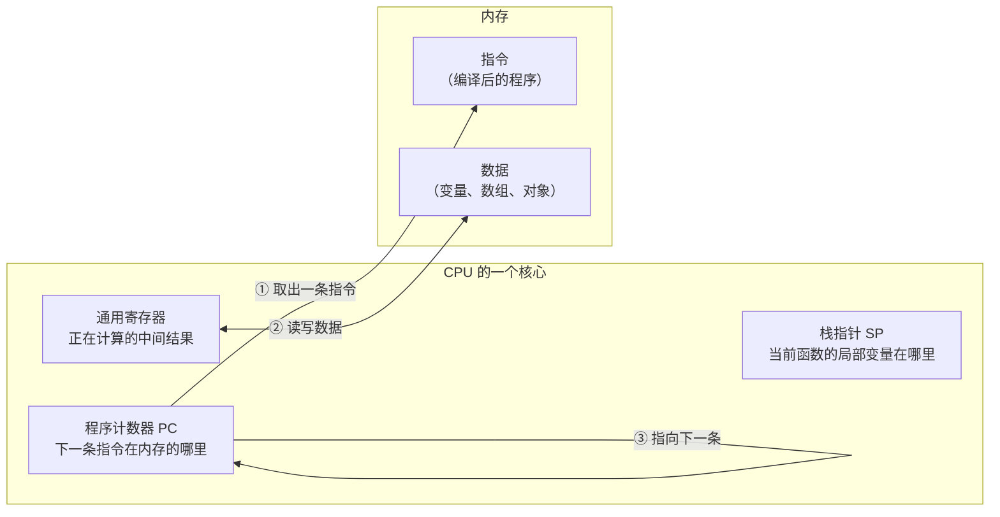
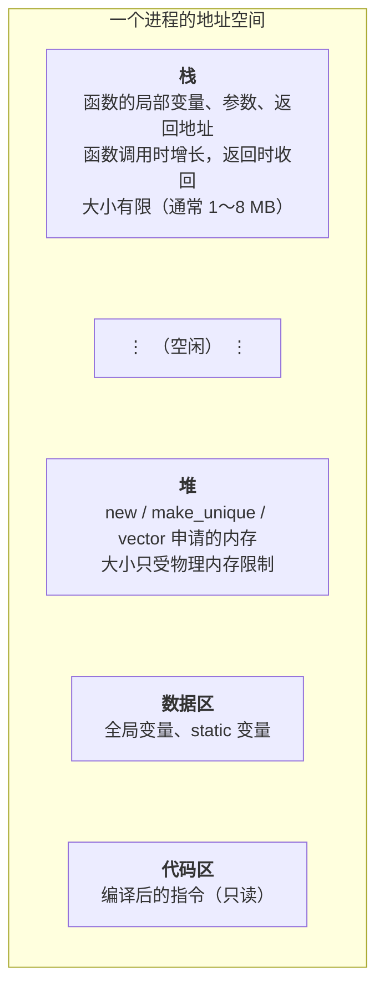
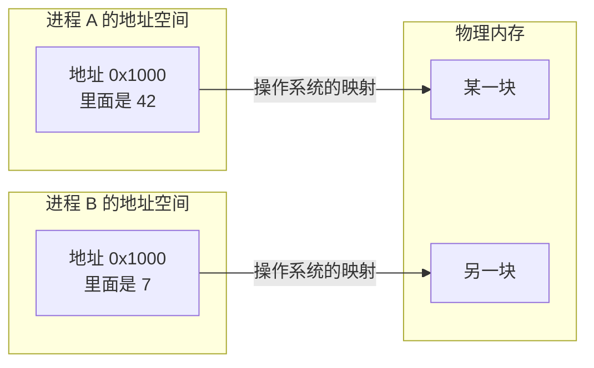
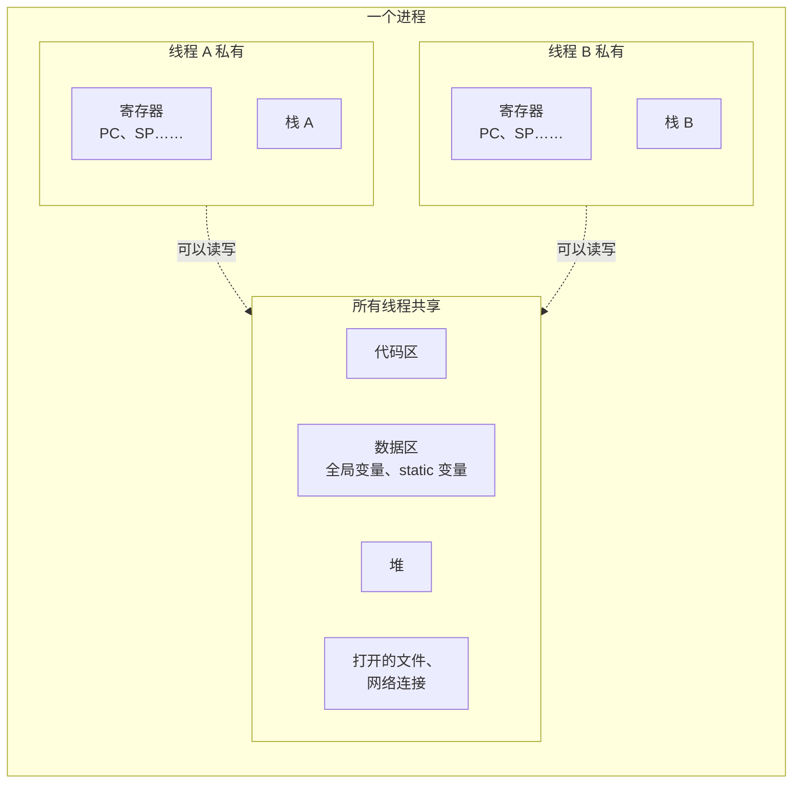
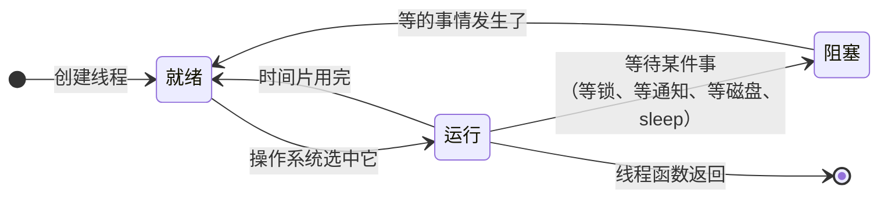
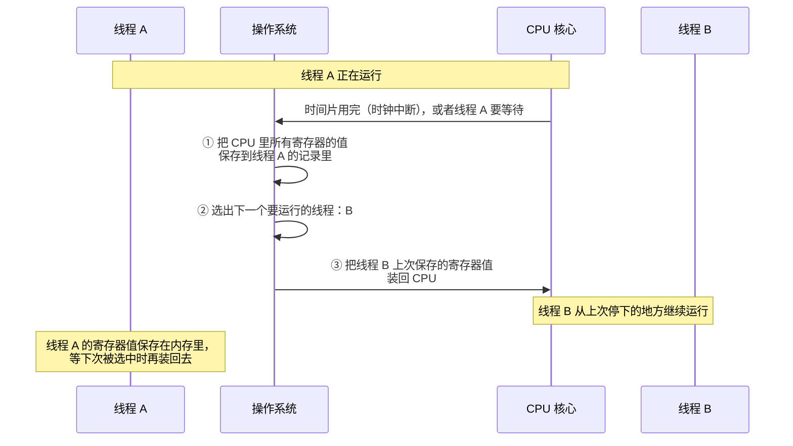
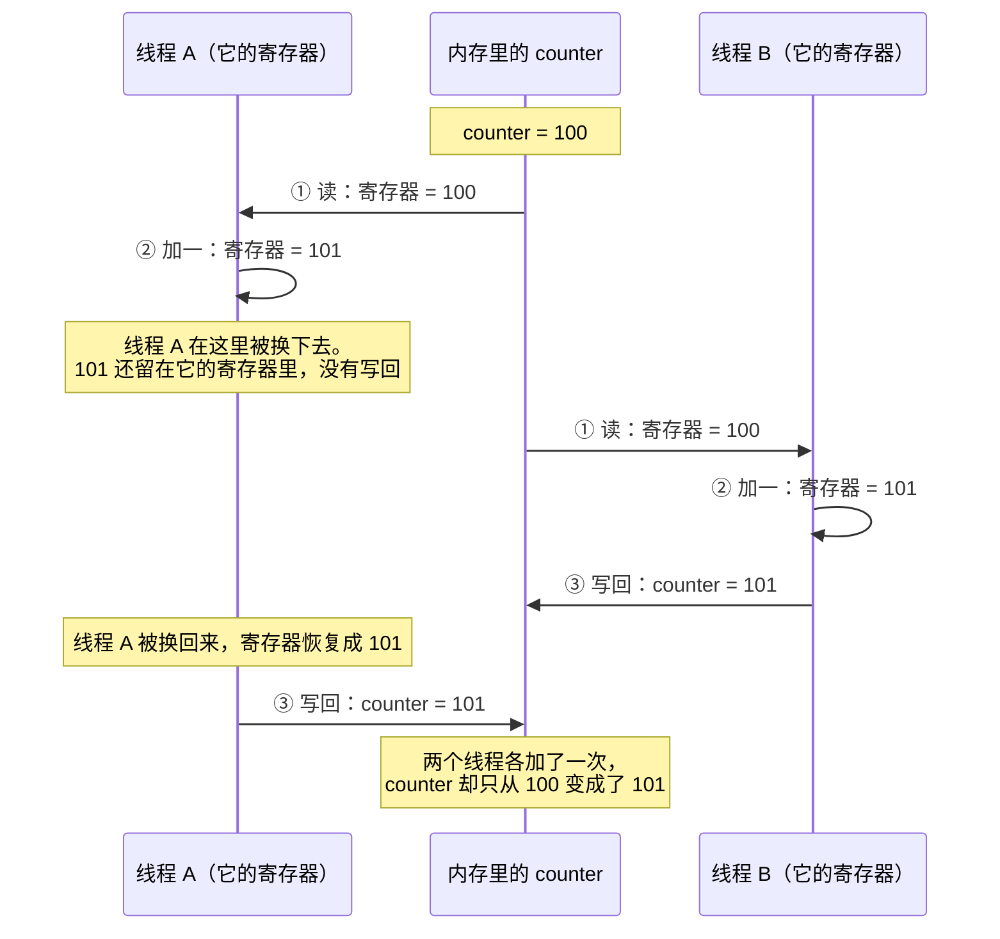
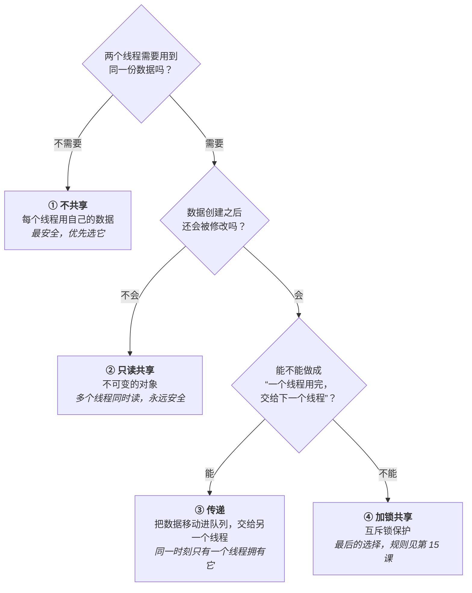
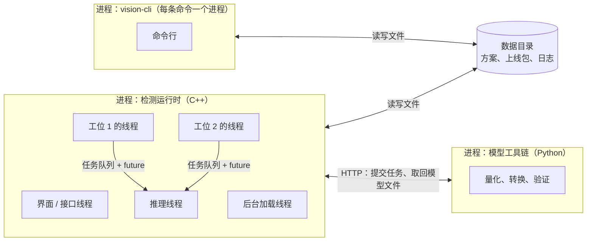

# 第 15 课（预备）：线程和进程到底是什么

> 预计用时：2 小时
> 示例代码：[`examples/lesson15a/`](examples/lesson15a/)
>
> 这是第 15、16 课的预备课。那两课讲怎么**用**线程；这一课讲线程**是什么**：它在计算机里长什么样，为什么会出现“数据竞争”这种问题。如果你已经学过操作系统，可以快速浏览。

## 这一课要回答的问题

1. 一个 CPU 核心同一时刻只能做一件事，电脑为什么能“同时”运行很多程序？
2. 进程是什么？线程是什么？它们是什么关系？
3. 线程之间哪些数据是共享的，哪些不是？
4. 线程切换时发生了什么，要花多少时间？
5. 什么时候该用线程，开多少个？什么时候该用进程？

这一课的图比较多。建议在 GitHub 网页上阅读，图会直接显示出来。

## 1. 先看 CPU 是怎么执行程序的

要理解线程，得先知道“执行程序”这件事在硬件上是什么样子。



CPU 的一个核心做的事情非常单调，一直重复三步：

1. 按**程序计数器**（PC）给出的地址，从内存里取出一条指令；
2. 执行它（做一次运算、读写一次内存、或者跳转到别处）；
3. 让 PC 指向下一条指令。

每秒重复几十亿次。

**寄存器**是 CPU 内部的几十个小存储单元，速度极快。运算都在寄存器里进行：先把数据从内存读进寄存器，算完再写回内存。

这里有一个关键的事实，后面所有内容都建立在它上面：

> **一个核心在某一时刻“正在做什么”，完全由它的寄存器里的值决定**：PC 说明执行到了哪里，SP 说明当前函数的局部变量在哪里，其他寄存器里是算到一半的结果。

所以，如果把所有寄存器的值保存下来，之后再原样放回去，程序就能从刚才停下的地方继续执行，自己完全察觉不到被打断过。**这就是“切换”的全部秘密。**

## 2. 进程：一个正在运行的程序

你双击一个程序，或者在命令行里输入 `./vision-cli`，操作系统就创建了一个**进程**。

**程序**是磁盘上的一个文件；**进程**是这个程序的一次运行。同一个程序运行两次，就是两个进程。

操作系统给每个进程分配一块属于它自己的内存，叫做**地址空间**，大致分成四个区域：



对照你写的 C++：

| 你写的代码 | 它在哪个区域 |
|---|---|
| `int counter = 0;`（写在函数外面） | 数据区 |
| `static int n;` | 数据区 |
| 函数里的 `int x; double buf[100];` | 栈 |
| `std::vector<int> v(1000000);` 这个变量本身（三个指针大小） | 栈 |
| 上面那个 `v` 里的 100 万个 `int` | 堆 |
| `std::make_unique<Model>()` 创建的对象 | 堆 |
| 函数本身的指令 | 代码区 |

### 栈为什么很小

栈的大小是固定的，常见的默认值是 Linux 8 MB、Windows 1 MB。函数调用层数太深（比如没有终止条件的递归），或者局部变量太大，就会用完，程序崩溃。这叫**栈溢出**。

```cpp
void process() {
    unsigned char image[2592 * 1944 * 3];   // 15 MB 的局部数组：栈溢出
}
```

竞赛里大数组都开成全局的，原因就在这里。工程里的做法是用 `std::vector`：它的数据在堆上（第 0 课）。

### 进程之间是隔离的



每个进程看到的地址都是“虚拟”的。操作系统和 CPU 配合，把它们映射到物理内存里**互不重叠**的位置。两个进程里同一个地址 `0x1000`，对应的是完全不同的物理内存。

后果：

- **一个进程看不到、也改不了另一个进程的内存。** 哪怕它有 bug、乱写内存，也只能弄坏自己。
- **一个进程崩溃，不影响其他进程。**
- **进程之间想交换数据，必须通过操作系统提供的途径**：文件、管道、网络、共享内存。

## 3. 线程：进程里的一条执行流

进程刚启动时，里面只有一条执行流：从 `main` 开始，一条指令接一条指令地执行。这条执行流就是一个**线程**，叫主线程。

一个进程里可以有多条执行流，每一条都是一个线程。**所有线程都在同一个进程的地址空间里。**



| | 每个线程自己有一份 | 所有线程共用一份 |
|---|---|---|
| 是什么 | 寄存器（包括 PC 和 SP）、栈 | 代码区、数据区、堆、打开的文件 |
| 意味着 | 每个线程有自己的“执行到了哪里”，有自己的局部变量 | 全局变量和堆上的对象，所有线程看到的是同一份 |

回想第 1 节的那句话：一个核心正在做什么，由寄存器决定。**一个线程，本质上就是“一套寄存器的值，加上一个栈”。** 创建一个线程，就是多准备一套寄存器的值和一块栈。

### 亲眼看一看

[`examples/lesson15a/address_space.cpp`](examples/lesson15a/address_space.cpp) 让三个线程各自打印四种东西的地址：

```
主线程
  代码（函数）  0x558d30dd4d60
  全局变量      0x558d30dd8194
  堆上的对象    0x558d37b3f2d0
  局部变量（栈）0x7fff826bdc88
线程 A
  代码（函数）  0x558d30dd4d60
  全局变量      0x558d30dd8194
  堆上的对象    0x558d37b3f2d0
  局部变量（栈）0x7fba571fedf4
线程 B
  代码（函数）  0x558d30dd4d60
  全局变量      0x558d30dd8194
  堆上的对象    0x558d37b3f2d0
  局部变量（栈）0x7fba569fddf4

线程 A 和线程 B 的栈相距约 8196 KB
```

（每次运行地址都不同，这是操作系统的安全措施。看规律。）

- **前三行在三个线程里完全相同。** 同一份代码，同一个全局变量，同一个堆对象。
- **只有局部变量的地址不同。** 每个线程有自己的栈。线程 A 和线程 B 的栈相距约 8 MB，正是 Linux 给每个线程分配的栈大小。

### 这解释了“数据共享”是怎么来的

**线程之间共享数据，不需要做任何特别的事。** 因为地址空间是同一个，线程 A 里的一个指针，拿到线程 B 里照样指向同一个对象。

这既是线程的方便之处，也是所有麻烦的来源：

| 数据 | 多个线程访问时 |
|---|---|
| 局部变量 | 在各自的栈上，天然互不干扰 |
| 全局变量、`static` 变量 | **共享** |
| 堆上的对象，通过指针、引用、`shared_ptr` 传给了多个线程 | **共享** |
| 局部变量，但把它的引用或指针交给了另一个线程 | **共享**，而且还要小心它的寿命（第 9 课的捕获规则） |

最后一行最容易被忽略：局部变量虽然在自己的栈上，但只要把它的地址交给别的线程，别的线程就能访问它。栈是“私有”的，只是说每个线程有自己的一块，并不是说别人访问不了。

## 4. 一个核心怎么“同时”运行多个线程

电脑上同时运行着几百个线程，核心却只有几个。操作系统的办法是**轮流**：让每个线程运行很短的一段时间（叫**时间片**，一般是几毫秒到几十毫秒），然后换下一个。

### 一个核心：轮流执行

| 时间 → | 0–10 ms | 10–20 ms | 20–30 ms | 30–40 ms | 40–50 ms | 50–60 ms |
|---|---|---|---|---|---|---|
| 核心 0 | 线程 A | 线程 B | 线程 C | 线程 A | 线程 B | 线程 C |

任何一个时刻只有一个线程在执行，但切换得足够快，看起来三个线程都在前进。这叫**并发**。

### 多个核心：真正同时执行

| 时间 → | 0–10 ms | 10–20 ms | 20–30 ms | 30–40 ms |
|---|---|---|---|---|
| 核心 0 | 线程 A | 线程 A | 线程 C | 线程 A |
| 核心 1 | 线程 B | 线程 C | 线程 B | 线程 B |

线程 A 和线程 B 在同一时刻分别运行在两个核心上。这叫**并行**。

| | 含义 | 需要多个核心吗 |
|---|---|---|
| **并发** | 多个任务在一段时间内都在推进 | 不需要 |
| **并行** | 多个任务在同一时刻真的同时执行 | 需要 |

注意两点：

- **哪个线程在什么时候运行、运行多久，由操作系统决定，程序控制不了，也预测不了。** 这就是多线程程序“每次运行结果可能不同”的根源。
- 线程可能在**任意两条指令之间**被换下去。

## 5. 线程的三种状态



| 状态 | 含义 | 占用 CPU 吗 |
|---|---|---|
| **运行** | 正在某个核心上执行 | 是 |
| **就绪** | 可以运行，在排队等核心 | 否 |
| **阻塞** | 在等某件事发生，等到之前不会被安排运行 | **否** |

**阻塞的线程不消耗 CPU。** 这一点非常重要：

```cpp
while (!hasFrame()) { }                    // 忙等：一直处于“运行”，白白占满一个核心
ready.wait(lock, [&] { return hasFrame(); });   // 阻塞：睡着等，不占 CPU，有帧了再被叫醒
```

第 15 课的条件变量做的就是第二种。一个程序可以有很多线程，只要它们大部分时间在阻塞，就不会互相抢 CPU。

## 6. 上下文切换

把一个核心从执行线程 A 换成执行线程 B，叫**上下文切换**。“上下文”就是第 1 节说的那套寄存器的值。



对线程 A 来说，它完全不知道自己被暂停过。下次轮到它时，寄存器的值和被暂停时一模一样，它接着执行下一条指令。

### 什么时候会切换

| 原因 | 例子 |
|---|---|
| 时间片用完 | 线程 A 已经连续运行了一个时间片 |
| 线程主动等待 | 加锁时锁被别人占着；`wait` 等通知；读文件等磁盘；`sleep_for` |
| 有更紧急的线程要运行 | 一个高优先级的线程从阻塞变成了就绪 |

### 切换要花多少时间

切换不是免费的。

- **直接开销**：保存和恢复寄存器、操作系统做调度，一般是几微秒。
- **间接开销**：新换上来的线程要用的数据不在 CPU 缓存里（缓存里还是上一个线程的数据），刚开始的一段时间会比较慢（第 14 课）。间接开销常常比直接开销更大。

[`examples/lesson15a/context_switch.cpp`](examples/lesson15a/context_switch.cpp) 让两个线程像打乒乓球一样轮流执行 10 万个来回，测量每次交接的耗时：

```
普通函数调用：每次约 1.4 纳秒
线程之间交接：每次约 12 微秒
```

这里测到的 12 微秒包含了通知对方、对方被唤醒、切换过去的全部过程。**一次交接的时间，够调用上千次函数。**

所以：

- 线程不是越多越好。线程多了，花在切换上的时间就多了。
- 不要把很小的工作一件一件地交给另一个线程。交接一次十几微秒，如果工作本身只要 1 微秒，就得不偿失。这也是第 16 课里推理要**成批**处理的原因之一。

## 7. 为什么需要线程

有两个完全不同的理由，对应的做法也不同。运行 [`examples/lesson15a/why_threads.cpp`](examples/lesson15a/why_threads.cpp)（4 个核心的机器）：

```
计算型任务（同样的总工作量，分给不同数量的线程）：
  1 个线程：455 ms，是单线程的 1 倍速
  2 个线程：270 ms，是单线程的 1.7 倍速
  4 个线程：129 ms，是单线程的 3.5 倍速
  8 个线程：145 ms，是单线程的 3.1 倍速
  16 个线程：134 ms，是单线程的 3.4 倍速

等待型任务（8 台相机，每台等 50 ms）：
  一个线程轮流等：401 ms
  8 个线程同时等：51 ms
```

### 理由一：用上多个核心（计算型任务）

图像处理、推理这类任务，CPU 一直在算。一个线程只能用一个核心，4 个核心的机器上，单线程程序最多用到四分之一的计算能力。

从数据里能看出三件事：

- **线程数不超过核心数时，基本上是几个线程就快几倍。** 4 个线程是 3.5 倍，没有到 4 倍，因为创建线程、汇总结果也要时间。
- **线程数超过核心数之后，不会更快。** 8 个、16 个线程和 4 个差不多，甚至略慢。核心只有 4 个，多出来的线程只是在排队，还增加了切换的开销。
- **结果完全相同。** 示例里每个线程只写自己的那一个结果，互不干扰，所以不需要锁。

**计算型任务：线程数 ≈ 核心数。** 用 `std::thread::hardware_concurrency()` 可以查到核心数。

### 理由二：等待的时候让 CPU 去做别的（等待型任务）

等相机出图、等磁盘、等网络时，线程处于阻塞状态，不占 CPU。8 个线程各等 50 毫秒，总共也只要 51 毫秒，哪怕只有 1 个核心也是如此。

**等待型任务：线程数可以远多于核心数。** 它们大部分时间在睡觉。

### 理由三：不让慢的事情挡住快的事情

界面线程如果亲自去做一次 200 毫秒的检测，这 200 毫秒里界面就没法响应鼠标。把检测放到另一个线程，界面始终流畅。

本项目里，后台加载新的上线包（可能要几秒）不能打断正在进行的检测，也是这个道理。

### 有一部分不能并行时

假设一次检测里，80% 的时间可以并行，20% 必须按顺序做。即使有无限多个核心，那 20% 也省不掉，所以**最多只能快到 5 倍**。这个规律叫阿姆达尔定律。动手并行化之前，先算一算能并行的部分占多少（第 14 课：先测量）。

## 8. 从硬件角度再看“数据竞争”

第 15 课会讲：两个线程同时执行 `++counter`，结果会出错。现在可以看清楚为什么了。

`++counter` 在 C++ 里是一条语句，编译后是三条指令：

```
① 把内存里 counter 的值读进寄存器
② 寄存器里的值加 1
③ 把寄存器里的值写回内存
```

`counter` 在数据区，是**共享**的；寄存器是每个线程**私有**的。线程可能在任意两条指令之间被换下去：



线程 A 被换回来时，寄存器里是它**被暂停时**的值 101。它不知道 `counter` 在这期间已经被别人改过了，照样把 101 写回去，线程 B 的那次加一就被覆盖了。

在多核机器上，两个线程真的同时执行，这种交错更容易发生，根本不需要等到时间片用完。

**根本原因只有一句话：对共享数据的操作被拆成了好几步，而线程可以在任意两步之间被打断。**

解决思路也就清楚了，只有两条路：

1. **不共享。** 每个线程只碰自己的数据。
2. **让这几步不能被打断。** 这就是第 15 课的互斥锁和原子变量。

## 9. 线程之间怎么共享数据

共享的方式有四种，**从上往下，越来越容易出错**。能用上面的，就不要用下面的。



| 方式 | 项目里的例子 | 需要锁吗 |
|---|---|---|
| **① 不共享** | 示例里每个线程只写 `partial` 数组中属于自己的那一格；每个工位有自己的执行计划和中间结果 | 不需要 |
| **② 只读共享** | `Image` 的像素放在 `shared_ptr<const ...>` 里，创建之后不再修改；`Roi` 等值对象不可变（第 5 课）；算子目录在启动时注册完，之后只读 | 不需要 |
| **③ 传递** | 第 16 课的推理队列：工位把图像**移动**进任务，交给推理线程；结果通过 `future` 交回来 | 只有队列本身需要 |
| **④ 加锁共享** | 事件总线的订阅列表；执行计划缓存 | 需要 |

前面几课一直强调的不可变值对象、移动语义、不要用全局变量，到这里显出了另一层价值：**它们让大部分数据根本不需要加锁。**

## 10. 进程还是线程

两者都能“同时做多件事”，区别在于隔离的程度。

| | 多个线程（一个进程里） | 多个进程 |
|---|---|---|
| 内存 | 共享同一个地址空间 | 各自独立，互相看不到 |
| 交换数据 | 直接传指针，几乎没有开销 | 必须通过文件、管道、网络、共享内存；数据要复制或转换格式 |
| 一个出错了 | **整个进程一起崩溃**，所有线程都没了 | 只有那个进程崩溃，其他的不受影响 |
| 一个有内存 bug | 可能写坏别的线程的数据，很难查 | 只能弄坏自己 |
| 创建和切换的开销 | 小 | 大 |
| 可以用不同的语言写吗 | 不可以 | 可以 |

选择的依据：

| 情况 | 选 |
|---|---|
| 要频繁交换大量数据（图像） | 线程 |
| 一部分崩溃不能连累另一部分 | 进程 |
| 两部分用不同的语言，或者依赖互相冲突的库 | 进程 |
| 要部署在不同的机器上 | 进程 |
| 其他情况 | 线程更简单，开销更小 |

### 本项目的选择



- **工位、推理、界面在同一个进程里，用线程。** 它们之间要频繁传递图像，共用同一份模型，用进程的话每张图都要复制，代价太大。
- **模型工具链是另一个进程。** 它用 Python 写，只能在 Linux 上运行，一个任务要跑几分钟，和实时检测没有任何需要紧密配合的地方。它出了问题，不应该影响产线上的检测（设计文档里的 BC-8）。
- **命令行工具每执行一条命令就是一个新的进程。** 你运行 `recipe build`、`recipe publish`、`inspect` 三条命令，是三个先后运行的进程。它们之间靠什么传递信息？靠数据目录里的**文件**：第一个进程把方案写进文件，第二个进程读出来。这就是进程间通信最朴素的一种形式。

### 一个值得思考的取舍

多个工位放在同一个进程里，意味着**一个工位的代码崩溃，所有工位一起停**。把每个工位做成一个独立的进程可以避免这一点，代价是模型要各加载一份，图像不能直接共享，结构也复杂得多。

本项目目前选择一个进程多个线程，再配上第 17 课的崩溃转储和自动重启。这是一个取舍，不是唯一正确的答案。练习第 5 题请你想一想另一种方案。

## 11. 正确使用线程的准则

把这一课的结论汇总一下。具体怎么写代码，是第 15、16 课的内容。

| 准则 | 依据 |
|---|---|
| **先问：真的需要线程吗？** 单线程够快就不要引入线程 | 多线程的 bug 最难查 |
| **计算型任务，线程数约等于核心数；等待型任务可以多** | 第 7 节的实测 |
| **优先不共享；其次只读共享；再次传递；最后才加锁** | 第 9 节 |
| **等待用阻塞，不要忙等** | 第 5 节：阻塞不占 CPU |
| **不要把太小的工作单独交给另一个线程** | 第 6 节：交接一次十几微秒 |
| **不要假设线程的执行顺序** | 第 4 节：顺序由操作系统决定 |
| **交给另一个线程的数据，要保证活得比那个线程久** | 第 3 节：栈上的变量会随函数返回而消失 |
| **每个线程都要有办法让它结束，并且等它结束** | 第 15 课 |
| **大的数据放在堆上，不要放在栈上** | 第 2 节：栈很小 |
| **需要隔离故障、跨语言、跨机器时，用进程** | 第 10 节 |

## 12. 动手运行

**macOS / Linux**：

```bash
clang++ -std=c++17 -O2 -pthread address_space.cpp -o address_space && ./address_space
clang++ -std=c++17 -O2 -pthread why_threads.cpp -o why_threads && ./why_threads
clang++ -std=c++17 -O2 -pthread context_switch.cpp -o context_switch && ./context_switch
```

**Windows**：

```bat
cl /std:c++17 /O2 /EHsc /utf-8 address_space.cpp && address_space.exe
cl /std:c++17 /O2 /EHsc /utf-8 why_threads.cpp && why_threads.exe
cl /std:c++17 /O2 /EHsc /utf-8 context_switch.cpp && context_switch.exe
```

文中的数字来自一台 4 核的 Linux 机器。你的机器核心数不同，结果也会不同，看规律。

## 13. 练习

1. **观察地址**：运行 `address_space`。你的机器上，两个线程的栈相距多少？和文中的 8 MB 一样吗？（Windows 和 macOS 给线程分配的栈比 Linux 小。）
2. **找到你的机器的拐点**：运行 `why_threads`。线程数增加到多少之后，计算型任务不再变快？它和程序开头打印的“逻辑核心数”是什么关系？
3. **制造栈溢出**：写一个函数，里面定义一个 `char buffer[64 * 1024 * 1024];` 并给第一个元素赋值，在 `main` 里调用它。程序会怎样？把它改成 `std::vector<char> buffer(64 * 1024 * 1024);` 再试。为什么这次没问题？
4. **判断共享**：下面的程序里，哪些变量是两个线程共享的？哪些不是？有没有数据竞争？

   ```cpp
   int total = 0;

   void add(int count, int* shared, int ownCopy) {
       int local = 0;
       for (int i = 0; i < count; ++i) { ++local; ++ownCopy; }
       *shared += local;
       total += local;
   }

   int main() {
       int sum = 0;
       std::thread a(add, 1000, &sum, 5);
       std::thread b(add, 1000, &sum, 5);
       a.join();
       b.join();
   }
   ```
5. **设计题**：如果把每个工位做成一个独立的进程，而不是一个线程：
   - 工位 A 的代码崩溃时，工位 B 会怎样？
   - 4 个工位用同一个 200 MB 的模型，一共占多少内存？
   - 推理还能“把 4 个工位的图像凑成一批”吗？要怎么做？
   - 你会在什么情况下选择这种方案？
6. **观察真实的进程和线程**：运行一个多线程的示例（比如 `why_threads`），同时用系统工具观察它。
   - Windows：任务管理器 → “详细信息”，在列标题上右键 → “选择列”，勾选“线程”。
   - macOS：活动监视器，在“显示”菜单里添加“线程”一列。
   - Linux：`top -H`，或者 `ps -eLf | grep why_threads`。

## 14. 自测题

1. 一个 CPU 核心“正在做什么”是由什么决定的？这和线程切换有什么关系？
2. 进程的地址空间分成哪几个区域？全局变量、局部变量、`vector` 里的数据分别在哪里？
3. 一个进程里的多个线程，哪些东西是各自私有的，哪些是共享的？
4. 为什么线程之间共享数据“不需要做任何特别的事”？
5. 并发和并行有什么区别？
6. 线程有哪三种状态？阻塞的线程占用 CPU 吗？
7. 上下文切换时，操作系统做了哪几件事？为什么切换有代价？
8. 4 个核心的机器上，计算型任务开 16 个线程会比开 4 个线程快吗？等待型任务呢？
9. `++counter` 为什么不是线程安全的？用“寄存器是私有的，内存是共享的”来解释。
10. 线程之间共享数据的四种方式是什么？按什么顺序选择？
11. 什么情况下应该用多个进程而不是多个线程？本项目里哪一部分是这样做的，为什么？

## 下一课

[第 15 课：并发基础——线程、互斥锁、条件变量](15-concurrency-basics.md)
