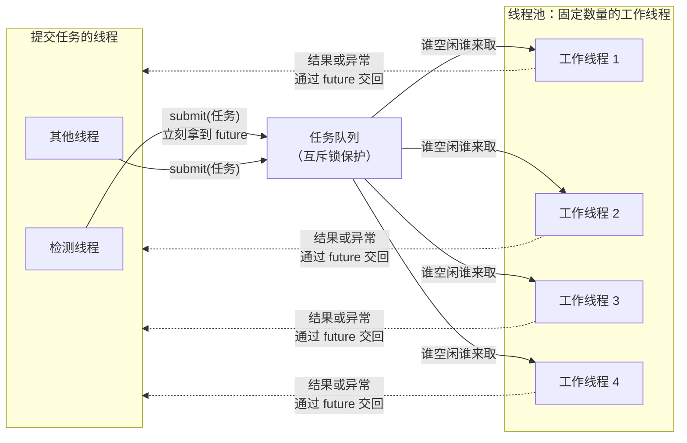
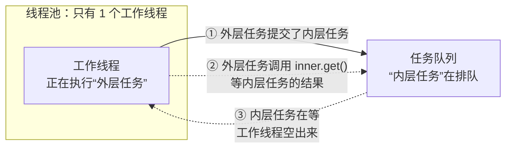
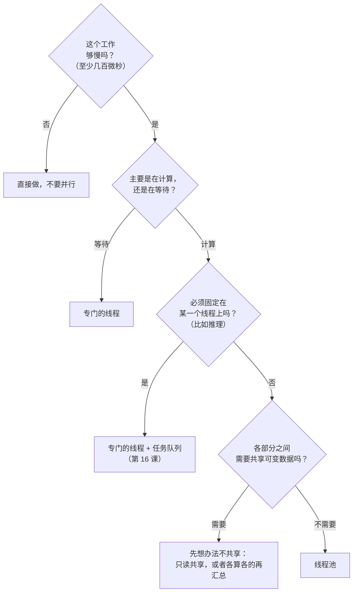

# 第 16 课（延伸）：线程池

> 预计用时：2 小时
> 示例代码：[`examples/lesson16a/`](examples/lesson16a/)
>
> 这是第 16 课的延伸。第 16 课的推理服务是“一个任务队列加**一个**工作线程”；线程池是“一个任务队列加**多个**工作线程”，任务可以是任意一段代码。

## 这一课要回答的问题

一次检测里，尺寸测量和划痕检测互不依赖，可以同时做。

1. 每次检测临时开几个线程去做，行不行？
2. 线程池是什么，怎么实现？
3. 用线程池有哪些容易踩的坑？
4. 什么时候不该用线程池？

## 1. 为什么不直接开线程

最直接的想法：有几个任务，就开几个线程。

[`examples/lesson16a/pool_vs_spawn.cpp`](examples/lesson16a/pool_vs_spawn.cpp) 有 4000 个小任务，每个大约 40 微秒的计算量。三种做法（4 核机器）：

```
按顺序做：            166 ms（每个任务约 42 微秒）
每个任务开一个线程：  186 ms
线程池（4 个线程）：   50 ms
```

**每个任务开一个线程，比一个线程按顺序做还慢。** 有 4 个核心可用，反而更慢了。

原因在预备课里讲过：创建一个线程，操作系统要给它分配栈、建立记录、安排调度，结束时还要回收。这些加起来要几十微秒，和任务本身的计算量差不多。省下的时间全都赔进去了。

另外还有两个问题：

- **线程数没有上限。** 来 4000 个任务就同时存在 4000 个线程，每个线程占一块栈，它们还要互相抢 4 个核心。
- **预备课的结论**：计算型任务，线程数超过核心数之后不会更快。

## 2. 线程池的思路

**线程只创建一次，然后反复使用。**



- 启动时创建固定数量的工作线程（一般等于核心数）。
- 工作线程没有任务时睡着等（条件变量），不占 CPU。
- 提交任务就是往队列里放一个“要执行的东西”，然后叫醒一个工作线程。
- 提交者立刻拿到一个 `future`，需要结果时再取。

和第 16 课的推理服务对比：

| | 推理服务（第 16 课） | 线程池 |
|---|---|---|
| 工作线程 | 1 个，独占模型 | 多个 |
| 任务是什么 | 一张图像 | 任意一段代码 |
| 一次取几个 | 一批 | 一个 |
| 结果怎么交回 | `promise` / `future` | `promise` / `future` |
| 队列、条件变量、停止 | 相同 | 相同 |

## 3. 实现

完整代码在 [`examples/lesson16a/thread_pool.h`](examples/lesson16a/thread_pool.h)，不到 100 行。用法：

```cpp
ThreadPool pool(4);
std::future<int> f = pool.submit([] { return 6 * 7; });
int answer = f.get();   // 42
```

### 成员

```cpp
std::mutex mutex_;                         // 保护 tasks_ 和 stopping_
std::condition_variable available_;        // 有任务了，或者要停止了
std::queue<std::function<void()>> tasks_;
bool stopping_ = false;
std::vector<std::thread> workers_;
```

任务的类型是 `std::function<void()>`：“一个不需要参数、没有返回值、可以被调用的东西”（第 9 课）。

### 工作线程

```cpp
void workerLoop() {
    while (true) {
        std::function<void()> task;
        {
            std::unique_lock<std::mutex> lock(mutex_);
            available_.wait(lock, [this] { return !tasks_.empty() || stopping_; });
            if (tasks_.empty()) return;        // 要停止了，并且队列已空
            task = std::move(tasks_.front());
            tasks_.pop();
        }          // ← 锁在这里释放
        task();    // 执行任务时不拿锁
    }
}
```

和第 16 课的 `workerLoop` 几乎一样：等到有任务或者要停止；取出一个；**释放锁之后**再执行。

### 提交任务

这是唯一有新东西的地方：

```cpp
template <typename Fn>
auto submit(Fn&& fn) -> std::future<std::invoke_result_t<std::decay_t<Fn>>> {
    using Result = std::invoke_result_t<std::decay_t<Fn>>;

    auto task = std::make_shared<std::packaged_task<Result()>>(std::forward<Fn>(fn));
    std::future<Result> result = task->get_future();
    {
        std::lock_guard<std::mutex> lock(mutex_);
        if (stopping_) throw std::runtime_error("线程池正在停止，不能再提交任务");
        tasks_.push([task] { (*task)(); });
    }
    available_.notify_one();
    return result;
}
```

逐行看：

**`template <typename Fn>`**：`submit` 是一个函数模板（第 10 课），可以接收任何可调用的东西。

**`std::invoke_result_t<...>`**：“调用 `fn` 会得到什么类型”。传进来的 lambda 返回 `int`，`Result` 就是 `int`，`submit` 返回的就是 `std::future<int>`。这一行看起来吓人，含义只有这么多。

**`std::packaged_task<Result()>`**：把“一个函数”和“一个 `promise`”打包在一起。

第 16 课里，我们自己写了这样的代码：

```cpp
try {
    promise.set_value(compute());          // 成功：把结果放进 promise
} catch (...) {
    promise.set_exception(std::current_exception());   // 失败：把异常放进 promise
}
```

`packaged_task` 把这几行包好了。调用它的时候，它执行里面的函数，并**自动**把返回值或者异常放进它自带的 `promise`。所以工作线程只需要写一句 `task()`，不用关心任务会返回什么、会不会抛异常。

**`std::make_shared`**：`packaged_task` 只能移动、不能复制（它里面有一个 `promise`），而 `std::function` 要求它装的东西必须可以复制。用 `shared_ptr` 包一层，lambda 捕获的是这个可以复制的智能指针。

### 停止

```cpp
~ThreadPool() {
    {
        std::lock_guard<std::mutex> lock(mutex_);
        stopping_ = true;
    }
    available_.notify_all();
    for (auto& worker : workers_) worker.join();
}
```

和第 16 课完全相同：在锁里设置标志，叫醒所有线程，等它们结束。队列里剩下的任务会被做完。

### 成员声明的顺序

`workers_` 是**最后**一个成员。成员按声明的顺序构造：线程一创建就开始运行 `workerLoop`，会立刻用到锁、条件变量和队列，所以这些必须先构造好。

## 4. 用线程池并行执行节点

[`examples/lesson16a/parallel_nodes.cpp`](examples/lesson16a/parallel_nodes.cpp) 模拟一次检测里的四个节点，它们都只读同一张 5MP 图像，互不依赖：

```
各节点单独的耗时：
  亮斑计数：3.4 ms
  直方图：2.1 ms
  边缘强度：3.8 ms
  模糊后暗区：28.9 ms
  合计：38.2 ms，其中最慢的一个：28.9 ms

1. 按顺序执行四个节点：            约 38 ms
2. 四个节点交给线程池：            约 33 ms
3. 再把最慢的节点按行分成 4 块：   约 16 ms

三种做法的结果完全相同
```

### 第一步：每个节点一个任务

```cpp
Results runInPool(ThreadPool& pool, const Gray& img) {
    auto bright = pool.submit([&img] { return countBright(img); });
    auto gray   = pool.submit([&img] { return dominantGray(img); });
    auto edge   = pool.submit([&img] { return edgeStrength(img); });
    auto dark   = pool.submit([&img] { return countDarkAfterBlur(img); });
    return {bright.get(), gray.get(), edge.get(), dark.get()};
}
```

四个节点同时执行，但只从 38 毫秒降到了 33 毫秒。

原因一眼就能从上面的数据里看出来：**最慢的那个节点自己就要 29 毫秒。** 四个节点同时开始，总时间取决于最后完成的那一个。其他三个加起来才 9 毫秒，省下的也就是这 9 毫秒里的一部分。

**并行之后的总时间，不可能比最慢的那个任务更短。** 这是预备课里阿姆达尔定律的又一个例子。

### 第二步：把最慢的任务拆开

那个慢节点对每个像素做同样的运算，每一行的结果只取决于它和上下两行。所以可以把图像按行分成 4 块，每块一个任务：

```cpp
for (int b = 0; b < blocks; ++b) {
    const int yBegin = img.height * b / blocks;
    const int yEnd   = img.height * (b + 1) / blocks;
    parts.push_back(pool.submit([&img, yBegin, yEnd] { return countDarkAfterBlur(img, yBegin, yEnd); }));
}
std::int64_t dark = 0;
for (auto& part : parts) dark += part.get();
```

这次降到了约 16 毫秒。

这是两种不同的并行方式：

| | 含义 | 例子 |
|---|---|---|
| **任务并行** | 不同的工作同时做 | 四个不同的节点各一个任务 |
| **数据并行** | 同一种工作，把数据分成几块同时做 | 一张图像按行分成 4 块 |

图像处理里，数据并行的收益通常大得多，因为数据量大、每个像素的运算相同。OpenCV 的很多函数内部已经做了数据并行。

### 为什么不需要锁

这个示例里没有一把锁。对照预备课的“共享数据的四种方式”：

- 图像 `img` 是**只读共享**：所有任务都只读它，没有任何任务修改它。
- 每个任务的结果通过自己的 `future` 交回，是**传递**。
- 没有任何任务写同一份数据。

按引用捕获 `img` 是安全的，因为函数在 `get()` 完所有结果之前不会返回，`img` 一直有效（第 9 课的捕获规则）。

### 先测量

第 1 步只快了一点点，第 2 步才明显变快。如果不先测出各节点的耗时，就不会知道应该去拆哪一个。**并行化之前，先测量（第 14 课）。**

## 5. 四个坑

[`examples/lesson16a/pitfalls.cpp`](examples/lesson16a/pitfalls.cpp) 把四个最常见的问题都做成了可以运行的演示。

### 坑一：任务里的异常无声无息地消失

```cpp
auto ignored = pool.submit([] { throw std::runtime_error("没有人会知道这个错误"); });
ignored.wait();      // 只等它结束，不取结果
```

异常被 `packaged_task` 接住，存进了 `future`。**只有调用 `get()` 的人才会收到它。** 没有人调用 `get()`，这个错误就消失了：程序照常运行，没有任何提示。

规则：**每个 `future` 都要 `get()`。** 即使任务没有返回值，也要 `get()` 一次，为的是收到它可能抛出的异常。

好的一面是工作线程不会被异常弄坏，后面的任务照常执行。

### 坑二：池里的任务等待同一个池里的另一个任务



外层任务占着唯一的工作线程，等内层任务的结果；内层任务在队列里，等这个工作线程空出来。**两边互相等，永远等不到。**

示例里用了带超时的等待，所以不会真的卡死：

```
外层任务等了 200 ms，内层任务一直没有开始：如果用的是 get()，整个线程池就卡死了
```

线程多一些也不能根本解决：只要所有工作线程都在执行“等待池里其他任务”的任务，就会卡死。负载一高就容易出现，而且很难重现。

规则：**不要在池里的任务中，等待同一个池里的另一个任务。** 需要拆分工作时，在外面（提交者那里）拆好再提交，就像上一节的 `runInPoolSplittingSlowNode` 那样。

### 坑三：会长时间等待的任务占满了线程池

```
一个瞬间就能算完的任务，等了 300 ms 才拿到结果
```

线程池有 2 个线程，先来了 2 个要等 300 毫秒的任务（模拟等相机、等网络）。之后来的计算任务只需要几纳秒，却要排队等前面的任务结束。

预备课讲过，等待型任务和计算型任务对线程数的要求完全不同。把它们放进同一个池里，等待型任务会占着线程不干活，把计算型任务饿死。

规则：**计算用的线程池里，只放计算任务。** 会长时间等待的工作，用专门的线程，或者另外开一个池。

### 坑四：任务切得太碎

把 400 万个数求和：

```
不用线程池，直接求和：                    1.6 ms
每个任务 100 个数（共 40000 个任务）：    493 ms
每个任务 10000 个数（共 400 个任务）：    3.9 ms
每个任务 1000000 个数（共 4 个任务）：    1.8 ms
```

切成 4 万个小任务，比直接求和慢了 300 倍。每提交一个任务都要申请内存、加锁、叫醒线程、再通过 `future` 取结果，这些开销远远超过了加 100 个数本身。

注意最后一行：即使只切成 4 个任务，也没有比直接求和快。因为求和这件事本身太快了，瓶颈在读内存，不在计算。**不是所有工作都值得并行。**

规则：**每个任务的工作量要远大于调度它的开销。** 一个粗略的标准是每个任务至少几百微秒。

## 6. 什么时候不该用线程池

| 情况 | 原因 | 用什么 |
|---|---|---|
| **推理** | 模型通常要求加载、推理、释放都在同一个线程；还要按批处理 | 专门的推理线程（第 16 课） |
| **会长时间等待的工作** | 占着线程不干活（坑三） | 专门的线程 |
| **需要严格按顺序执行的工作** | 线程池不保证任务的执行顺序 | 一个线程加一个队列 |
| **工作本身很快** | 调度的开销比工作还大（坑四） | 直接做 |
| **任务之间要共享可变的数据** | 要加锁，容易出错，收益也会被锁抵消 | 先想办法不共享 |



## 7. 线程数怎么定

接预备课的结论：

- **计算用的线程池：线程数等于核心数。** `std::thread::hardware_concurrency()`。
- **一个程序里只要一个计算线程池。** 如果每个模块各建一个池，加起来线程数是核心数的好几倍，又回到了互相抢核心的局面。
- **多个工位共用同一个池。** 4 个工位各自建 4 个线程的池，就是 16 个线程抢 4 个核心。
- 还要给不在池里的线程留余地：推理线程、相机线程、界面线程。它们大部分时间在等待，一般不需要专门减少池的大小，但如果推理也用 CPU 计算，就要考虑进去。

## 8. 这个实现缺什么

这是一个教学用的最小实现。实际使用时可能还需要：

| 缺少的 | 说明 |
|---|---|
| 队列容量上限 | 现在队列可以无限增长。第 16 课的推理服务有背压，这里没有 |
| 取消 | 已经提交的任务没法撤回 |
| 优先级 | 所有任务先来先做 |
| 每个线程自己的队列 | 所有线程共用一个队列、一把锁。任务很多很小时，锁会成为瓶颈。成熟的实现让每个线程有自己的队列，空闲时去别的线程那里“偷”任务 |

如果以后需要这些，更合理的做法是用成熟的库，而不是自己一点点加。

## 9. 和本项目的关系

**项目代码里现在没有线程池，也暂时不加。** POC-1 实测一次检测约 8 毫秒，离 100 毫秒的要求很远，并行化没有收益，只会增加复杂度。

架构文档里计划了“同一层里互不依赖的节点并行执行”（P1）。真的需要时：

- 执行计划里已经有了节点的依赖关系（拓扑排序的结果），可以算出哪些节点能同时执行。
- 节点之间传递的是不可变的值（`Image`、`Region`……），天然是只读共享，不需要锁。
- 所有工位共用一个计算线程池。
- 推理节点不进线程池，仍然走第 16 课的推理服务。
- 先用第 14 课的方法测出哪些节点慢，再决定并行什么。

## 10. 动手运行

**macOS / Linux**：

```bash
clang++ -std=c++17 -O2 -pthread pool_vs_spawn.cpp -o pool_vs_spawn && ./pool_vs_spawn
clang++ -std=c++17 -O2 -pthread parallel_nodes.cpp -o parallel_nodes && ./parallel_nodes
clang++ -std=c++17 -O2 -pthread pitfalls.cpp -o pitfalls && ./pitfalls
```

**Windows**：

```bat
cl /std:c++17 /O2 /EHsc /utf-8 pool_vs_spawn.cpp && pool_vs_spawn.exe
cl /std:c++17 /O2 /EHsc /utf-8 parallel_nodes.cpp && parallel_nodes.exe
cl /std:c++17 /O2 /EHsc /utf-8 pitfalls.cpp && pitfalls.exe
```

文中的数字来自一台 4 核的 Linux 机器，多次运行会有波动，看比例。

## 11. 练习

1. **读懂实现**：打开 `thread_pool.h`，对照第 16 课的 `inference_worker.cpp`，找出两者结构上相同的地方和不同的地方。
2. **换个线程数**：在 `pool_vs_spawn.cpp` 里，把线程池的线程数分别改成 1、2、8、16，记录耗时。超过核心数之后变快了吗？
3. **亲手卡死一次**：把 `pitfalls.cpp` 坑二里的 `inner.wait_for(200ms)` 改成 `inner.get()`，运行。程序会怎样？用调试器中断它，查看所有线程的调用栈（第 12 课），找到互相等待的两处。然后改回去。
4. **加上容量上限**：给 `ThreadPool` 的构造函数增加一个参数 `maxQueued`。队列里的任务达到这个数量时，`submit` 阻塞等待，直到有空位（参考第 16 课的 `notFull_`）。想一想：如果是池里的任务调用 `submit` 时被阻塞了，会发生什么？
5. **并行求最大值**：写一个函数，用线程池求一张图像里最亮的像素值：把图像按行分成若干块，每块一个任务求出块内的最大值，最后汇总。块数取多少合适？用 ThreadSanitizer 确认没有数据竞争。
6. **设计题**：一次检测的执行计划是 `输入 → 灰度 → {阈值 → Blob, 边缘 → 卡尺测量} → 判定`，大括号里是两条互不依赖的分支。哪些节点可以同时执行？如果“灰度”占了总时间的 70%，并行这两条分支最多能快多少？

## 12. 自测题

1. “每个任务开一个线程”有什么问题？
2. 线程池的基本思路是什么？它和第 16 课的推理服务有什么相同和不同？
3. `std::packaged_task` 做了什么？如果没有它，工作线程里要多写哪几行？
4. `ThreadPool` 里 `workers_` 为什么必须最后声明？
5. 四个节点交给线程池并行，为什么只快了一点点？后来是怎么变快的？
6. 任务并行和数据并行有什么区别？
7. 任务里抛出的异常去了哪里？怎样才不会漏掉？
8. 为什么池里的任务不能等待同一个池里的另一个任务？
9. 为什么不能把等相机、等网络这样的工作放进计算用的线程池？
10. 推理为什么不放进线程池？

## 下一课

[第 17 课：日志与崩溃转储](17-logging-and-core-dumps.md)
