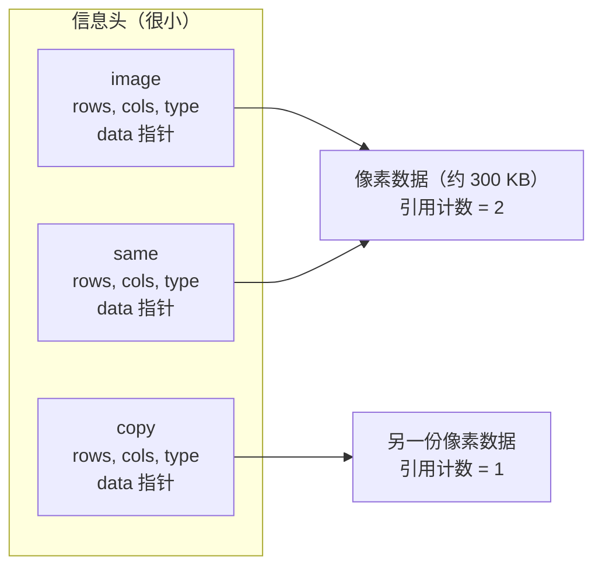

# 第 1 课：图像与 cv::Mat

> 预计用时：2 小时
> 示例代码：[`examples/lesson01/`](examples/lesson01/)
> 需要先学过：C++ 教程第 03 课（值、引用与移动）、第 04 课（RAII 与智能指针）

## 这一课要回答的问题

1. 一张图像在程序里是什么？
2. 怎样读一张图像、保存一张图像？读不到会怎样？
3. 怎样读写某一个像素？
4. `cv::Mat b = a;` 复制了什么？
5. 路径里有中文，为什么在 Windows 上读不到图？

## 1. 图像就是一个二维数组

一张灰度图像，就是一张填满数字的表格。每个格子是一个**像素**，里面的数字表示这一点有多亮：0 是黑，255 是白，中间是深浅不同的灰。

```
         x →   0    1    2    3   ...  639        （列）
   y  0      170  171  169  170  ...  168
   ↓  1      172  170  170  169  ...  171
      2      169   70   71   70  ...  170
     ...
     479     170  169  171  170  ...  169
  （行）
```

竞赛里你会写 `int a[480][640]`。图像就是这个东西，只是每个数字只占 1 个字节（`unsigned char`，0～255）。

两件事从一开始就要记牢，后面所有的错误有一半出在这里：

- **原点在左上角**，x 向右，y 向**下**。和数学课上的坐标系上下相反。
- **“行、列”和“x、y”的顺序相反**。第 `y` 行第 `x` 列的像素：说行列时先说 y，说坐标时先说 x。

## 2. cv::Mat

OpenCV 用 `cv::Mat`（matrix，矩阵）表示图像。

```cpp
// 480 行、640 列；CV_8UC1：每个像素是 1 个 8 位无符号整数；初始值全是 0
cv::Mat image(480, 640, CV_8UC1, cv::Scalar(0));

image.rows        // 480，行数，也就是高
image.cols        // 640，列数，也就是宽
image.channels()  // 1，每个像素有几个数（第 2 课）
image.type()      // CV_8UC1
image.empty()     // 是不是一张空图像
```

类型的名字是拼出来的：

```
CV_ 8 U C1
    │ │ └─ 通道数（Channel）：每个像素有 1 个数
    │ └─── 无符号整数（Unsigned）
    └───── 每个数占 8 位
```

现在只需要认识 `CV_8UC1`（灰度图）和 `CV_8UC3`（彩色图）。其他的第 2 课讲。

构造函数的参数顺序是**先行数（高），后列数（宽）**。而 `cv::Size(宽, 高)`、`cv::Rect(x, y, 宽, 高)`、`cv::Point(x, y)` 都是先 x 方向。OpenCV 里这两种顺序并存，写的时候每次都要想一下。

## 3. 读写像素

### 3.1 读写一个像素：at

```cpp
image.at<uchar>(100, 200) = 255;     // 第 100 行、第 200 列：先 y，后 x
uchar v = image.at<uchar>(100, 200);
```

尖括号里的类型必须和图像的类型对应：`CV_8UC1` 对应 `uchar`。**写错了也能编译**，只是读到的数没有意义（第 2 课有例子）。

`at` 也接受 `cv::Point`，这时是 (x, y)：

```cpp
const cv::Point p(200, 100);     // x = 200，y = 100
image.at<uchar>(p)               // 和 image.at<uchar>(100, 200) 是同一个像素
```

### 3.2 遍历整张图：按行取指针

```cpp
for (int y = 0; y < image.rows; ++y) {
    uchar* row = image.ptr<uchar>(y);          // 这一行第一个像素的地址
    for (int x = 0; x < image.cols; ++x) {
        row[x] = static_cast<uchar>(x * 255 / (image.cols - 1));
    }
}
```

这段代码画出一个从左到右由黑变白的渐变（`01_gradient.png`）。

外层循环行、内层循环列，这个顺序不是随意的：像素在内存里是一行接一行存放的，按这个顺序访问最快（C++ 教程第 14 课）。

**但是大多数时候不应该自己写循环。** OpenCV 的函数内部做了大量优化，比手写的循环快得多，也不容易错。自己遍历像素只在两种情况下用：学习的时候，和确实没有现成函数的时候。

## 4. 复制 Mat 不会复制像素

这是 `cv::Mat` 最重要、也最容易出错的一点。

```cpp
cv::Mat same = image;           // 没有复制像素
cv::Mat copy = image.clone();   // 复制了一份像素

same.at<uchar>(10, 10) = 77;    // image 的 (10, 10) 也变成了 77
copy.at<uchar>(20, 20) = 99;    // image 不受影响
```

`cv::Mat` 分成两部分：



- **信息头**：行数、列数、类型，以及一个指向像素数据的指针。几十个字节。
- **像素数据**：真正的图像内容，带一个引用计数。

`cv::Mat b = a;` 只复制信息头，两个 `Mat` 指向同一份像素，引用计数加一。最后一个 `Mat` 销毁时像素才被释放。

你在 C++ 教程第 4 课见过这个机制：它就是 `std::shared_ptr`。`cv::Mat` 相当于一个“指向像素的 `shared_ptr`”再加上尺寸信息。

为什么这样设计？一张 5MP 的图像有 5 MB，如果每次传参、每次返回都复制一遍，程序会非常慢。

由此得到三条规则：

| 情况 | 做法 |
|---|---|
| 把图像传给函数，函数只读 | `const cv::Mat&`。注意：`const` **拦不住**通过另一个共享的 `Mat` 修改像素 |
| 想要一份独立的、改了不影响别人的图像 | `clone()` |
| 函数要把结果写进参数里 | `cv::Mat&`，这是 OpenCV 自己的函数的习惯 |

> **和平台的关系**：平台的 `Image` 类（[`core/kernel/include/vision/kernel/image.h`](../../../core/kernel/include/vision/kernel/image.h)）也是共享像素的，但它是**不可变**的：创建之后像素不能再改。这样“共享”就不会带来“被别人改了”的问题。`cv::Mat` 没有这个保证，所以平台只在算子内部使用 `cv::Mat`，算子之间传递的是 `Image`。

## 5. 取出一块区域：ROI

**ROI**（Region of Interest，感兴趣区域）是图像处理里最常用的概念之一：只处理图像的一部分。

```cpp
const cv::Rect area(200, 150, 240, 180);   // x, y, 宽, 高
cv::Mat roi = image(area);                 // 没有复制像素

roi.setTo(0);                              // 把这块区域涂黑：原图对应的位置也黑了
```

`image(area)` 得到的 `Mat` 仍然指向原图的像素，只是信息头里记的起点和大小不同。所以取 ROI 几乎不花时间，往 ROI 里写就是往原图里写（`01_roi_blackened.png`）。想要独立的一块，写 `image(area).clone()`。

ROI 带来一个细节：它的像素在内存里**不连续**。ROI 的每一行后面，隔着原图里不属于它的那部分像素。

```
原图的一行：  [ ...不属于 ROI... | ROI 的这一行 | ...不属于 ROI... ]
```

所以**不能**把 `mat.data` 当成一个长度为 `rows × cols` 的一维数组来用。用 `ptr<uchar>(y)` 逐行访问总是对的。`mat.isContinuous()` 可以查询是否连续。

`cv::Rect` 超出图像范围时，`image(area)` 会抛出异常。和图像求交集可以保证安全：

```cpp
const cv::Rect safe = area & cv::Rect(0, 0, image.cols, image.rows);
```

## 6. 读取和保存

### 6.1 基本用法

```cpp
cv::imwrite("part.png", image);                              // 保存，格式由扩展名决定
cv::Mat loaded = cv::imread("part.png", cv::IMREAD_UNCHANGED);
```

### 6.2 读取失败不会报错

```cpp
const cv::Mat missing = cv::imread("not_exist.png");
// missing.empty() == true。没有异常，程序照常往下走。
```

文件不存在、路径写错、文件损坏，`imread` 都只是返回一张空图像。如果不检查，错误会在后面某个函数里才冒出来，报的是一条和“文件没找到”毫无关系的信息。

**每次读图之后都要检查 `empty()`。**

```cpp
cv::Mat image = cv::imread(path, cv::IMREAD_UNCHANGED);
if (image.empty()) {
    // 报告：读不到 path
}
```

这是 C++ 教程第 6 课讲的那类接口：失败不通过异常报告，而是通过返回值，调用的人必须检查。平台里把它包装成了返回 `Result<Image>` 的函数，这样就不可能忘记检查。

### 6.3 第二个参数决定通道数

| 写法 | 结果 |
|---|---|
| `cv::IMREAD_COLOR`（**默认**） | 总是 3 通道。灰度图也会被转成 3 通道 |
| `cv::IMREAD_GRAYSCALE` | 总是 1 通道。彩色图会被转成灰度 |
| `cv::IMREAD_UNCHANGED` | 文件里是什么就是什么 |

注意默认值：不写第二个参数，一张灰度图读进来是 3 通道的，占 3 倍内存，后面按灰度图处理还会出错。建议**总是写明**第二个参数。

### 6.4 PNG 和 JPEG

| | PNG | JPEG |
|---|---|---|
| 压缩 | **无损**：读回来和保存前每个像素都相同 | **有损**：读回来不完全相同 |
| 文件大小（示例里的零件图） | 163,629 字节 | 47,766 字节 |
| 像素值最大相差 | 0 | 16 |

JPEG 为了让文件更小，会丢掉人眼不容易察觉的细节。人看不出来，但是数值变了：示例里最多的一个像素差了 16。对测量和缺陷检测来说，这足以影响结果，边缘附近尤其明显。

**用于检测的图像用 PNG 或 BMP 这样的无损格式保存。** JPEG 只用于给人看的缩略图、报告。

## 7. 路径里有中文

在 Windows 上，`cv::imread("D:/数据/零件.png")` 经常读不到文件，返回空图像。在 macOS 和 Linux 上没有这个问题。

原因是字符编码。同一个汉字，用不同的编码方式存成的字节不同。我们的源文件和程序内部用 UTF-8，而 Windows 上 `imread` 内部打开文件时，把路径当成系统默认的编码（中文 Windows 是 GBK）。它拿着按 GBK 解释出来的一串乱码去找文件，自然找不到。

办法是**不让 OpenCV 打开文件**：自己把文件的字节读进内存，再让 OpenCV 在内存里解码。

```cpp
// 读：文件 → 字节 → 图像
std::ifstream file(std::filesystem::u8path("D:/数据/零件.png"), std::ios::binary);
std::vector<uchar> bytes((std::istreambuf_iterator<char>(file)), std::istreambuf_iterator<char>());
cv::Mat image = cv::imdecode(bytes, cv::IMREAD_UNCHANGED);

// 写：图像 → 字节 → 文件
std::vector<uchar> encoded;
cv::imencode(".png", image, encoded);
std::ofstream out(std::filesystem::u8path("D:/数据/结果.png"), std::ios::binary);
out.write(reinterpret_cast<const char*>(encoded.data()), static_cast<std::streamsize>(encoded.size()));
```

`std::filesystem::u8path` 明确告诉标准库“这个字符串是 UTF-8 编码的”，它在每个系统上都能正确打开文件。

示例程序会把两种办法都试一遍。在 Linux 上的输出是“直接用 imread 读中文路径：成功”。在 Windows 上的输出我们还没有记录（自动构建只在测试失败时才显示输出），请自己运行一次看看；而 `imdecode` 的办法在 Windows 和 Linux 的自动构建里都通过了检查。

> **和平台的关系**：平台读写图像用的就是这个办法，见 [`adapters/imaging/src/cv_bridge.cpp`](../../../adapters/imaging/src/cv_bridge.cpp)。产线上的目录名、产品名常常是中文，这是必须处理的问题（设计决定 ADR-23）。教程示例的 `cvtut::save` 和 `cvtut::load` 也是这样实现的。

## 8. 动手运行

先按 [构建说明](../../dev/build.md) 编译项目。然后（macOS / Linux）：

```bash
./build/docs/tutorial/opencv/examples/cv01_mat_basics build/tutorial-out/opencv/lesson01
```

```bash
./build/docs/tutorial/opencv/examples/cv01_read_write build/tutorial-out/opencv/lesson01
```

Windows 上把路径换成 `build\docs\tutorial\opencv\examples\cv01_mat_basics.exe`。

打开 `build/tutorial-out/opencv/lesson01/`，对照代码看这几张图：

| 文件 | 内容 |
|---|---|
| `01_gradient.png` | 第 3.2 节的渐变 |
| `01_roi_blackened.png` | 第 5 节：通过 ROI 把原图的一块涂黑 |
| `01_drawing.png` | 用 OpenCV 的画图函数画的矩形、圆和文字 |
| `01_part.png`、`01_part.jpg` | 同一张图的 PNG 和 JPEG。放大看边缘，能看出区别吗？ |

## 9. 练习

1. **坐标**：创建一张 300×200（宽 300，高 200）的黑色图像，把右下角的像素设成白色。先写出 `at` 的两个参数，再运行检查。然后故意把两个参数写反，看看会发生什么。
2. **棋盘**：画一个 8×8 的黑白棋盘，每格 50×50 像素。先用两层循环加 `at` 写一遍，再用 `cv::rectangle` 或 ROI 加 `setTo` 写一遍。
3. **共享**：写一个函数 `void drawCross(cv::Mat image)`（注意是传值），在图像中心画一个十字。调用之后，调用者手里的图像变了吗？为什么？和 C++ 教程第 3 课讲的“传值会复制”矛盾吗？
4. **边界**：写一个函数，给定图像和一个中心点，返回以它为中心的 100×100 的 ROI。中心点靠近图像边缘时不能抛异常。
5. **JPEG 的损失在哪里**：把 `01_part.png` 和 `01_part.jpg` 都读进来，用 `cv::absdiff` 求差，把差乘以 10 之后保存成图像。差别集中在图像的哪些位置？
6. **读图检查**：写一个函数 `bool loadGray(const std::string& path, cv::Mat& out)`，读取失败时返回 `false` 并打印是哪个文件。学完 C++ 教程第 6 课之后，把它改成返回 `Result<cv::Mat>`。

## 10. 自测题

1. 图像的原点在哪里？y 轴朝哪个方向？
2. `cv::Mat(480, 640, CV_8UC1)` 的宽和高分别是多少？
3. `image.at<uchar>(30, 50)` 和 `cv::Point(30, 50)` 指的是同一个像素吗？
4. `cv::Mat b = a;` 之后修改 `b` 的像素，`a` 会变吗？怎样得到独立的副本？
5. `cv::Mat` 的这种机制和 C++ 标准库里的什么最像？
6. 函数参数写成 `const cv::Mat&`，能保证函数里不会改到调用者的像素吗？
7. 为什么不能把 ROI 的 `data` 当作连续的一维数组？
8. `imread` 读不到文件时会怎样？应该怎么做？
9. `imread` 不写第二个参数，读一张灰度图会得到几个通道？
10. 为什么用于检测的图像不能存成 JPEG？
11. Windows 上中文路径读不到图的原因是什么？怎么解决？

## 下一课

[第 2 课：通道与数据类型](02-channels-and-depth.md)
