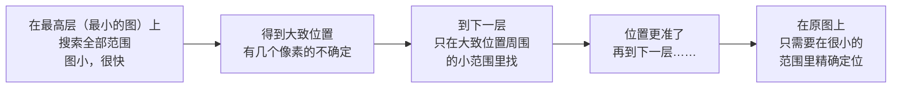

# 第 7 课：几何变换

> 预计用时：2.5 小时
> 示例代码：[`examples/lesson07/`](examples/lesson07/)

## 这一课要回答的问题

前面的操作改变的都是像素的**值**。这一课改变的是像素的**位置**：把图像缩小、平移、旋转。

1. 图像缩小或旋转之后，新的像素值从哪里来？
2. 怎样描述平移和旋转？旋转的角度朝哪个方向？
3. 旋转之后图像的四个角去哪了？
4. 图像金字塔是什么，有什么用？

这一课是大作业的直接准备：带旋转角度的模板匹配，需要把模板旋转到各个角度，需要在缩小的图像上先粗略地找。

## 1. 插值：新的像素值从哪里来

把一张 400 像素宽的图缩小到 100 像素宽，新图里的每个像素对应原图里 4 个像素宽的一小块。把图旋转 30 度，新图里的一个像素对应的原图位置一般不在整数坐标上，比如 (123.4, 56.7)。那里没有像素，值是多少？

用周围的像素算出来。这叫**插值**。

| 方法 | 做法 | 特点 |
|---|---|---|
| `cv::INTER_NEAREST` 最近邻 | 取离得最近的那个像素 | 最快；不产生新的灰度值；有锯齿 |
| `cv::INTER_LINEAR` 双线性（**默认**） | 取周围 4 个像素，按距离加权平均 | 平滑；一般情况都用它 |
| `cv::INTER_CUBIC` 双三次 | 取周围 16 个像素 | 更锐利；更慢 |
| `cv::INTER_AREA` 区域平均 | 取对应的那一小块里所有像素的平均 | **缩小**时用它 |

### 1.1 缩小时选错方法的后果

示例：一张黑白相间的竖条纹图（黑 2 像素、白 2 像素……），缩小到 1/4。

```
最近邻得到的平均灰度 0，区域平均得到 128（原图平均 127.5）
```

- **最近邻**：每 4 个像素里挑 1 个。条纹正好 4 个像素一个周期，每次都挑到黑的那一个，**整张图变成了纯黑**（`07_stripes_nearest.png`）。条纹完全消失，换成了原图里根本不存在的东西。
- **区域平均**：每一块里 2 个黑、2 个白，平均是中间的灰色。这才是从远处看这张条纹图的样子（`07_stripes_area.png`）。

这种“细节比采样间隔还细，结果变成了错误的图案”的现象叫**混叠**。拍电脑屏幕时出现的波纹就是它。

规则：**缩小图像时，用 `INTER_AREA`，或者先滤波再缩小。** 默认的双线性插值在缩小到一半以下时同样会混叠。

### 1.2 放大

把一个 8×8 的小圆放大 20 倍：

- 最近邻：只有 0 和 255 两种值，是一格一格的方块（`07_enlarge_nearest.png`）。
- 双线性：边缘上有平滑的过渡（`07_enlarge_linear.png`）。

放大不会增加信息。放大后的图像看起来更大，但并没有比原图多出任何细节。

### 1.3 什么时候必须用最近邻

**标签图像和掩膜。** 第 5 课的标签图像里，每个像素的值是“第几块”。对它做双线性插值，第 2 块和第 4 块的交界处会算出 3，凭空多出一个不存在的块。掩膜也一样：插值会在边界上产生 0 和 255 之间的值。这类“值是类别而不是亮度”的图像，只能用最近邻。

## 2. 仿射变换：用矩阵描述平移和旋转

### 2.1 矩阵

平移、旋转、缩放以及它们的组合，都可以写成同一种形式：

```
新 x = a·x + b·y + tx
新 y = c·x + d·y + ty
```

六个数排成一个 2 行 3 列的矩阵：

```
| a  b  tx |
| c  d  ty |
```

`cv::warpAffine` 按这个矩阵变换整张图像。**平移**最简单：

```cpp
//   新 x = 1·x + 0·y + 30.5
//   新 y = 0·x + 1·y + 12
const cv::Mat shift = (cv::Mat_<double>(2, 3) << 1, 0, 30.5, 0, 1, 12);
cv::warpAffine(dot, shifted, shift, dot.size());
```

```
平移 (30.5, 12)：重心从 (100, 80) 移到 (130.5, 92)
```

可以平移半个像素：靠插值，每个新像素是原来相邻两个像素的平均。

### 2.2 旋转

旋转矩阵里是正弦和余弦，不用自己写：

```cpp
const cv::Mat rotation = cv::getRotationMatrix2D(center, 30, 1.0);   // 绕 center 转 30 度，缩放 1.0 倍
cv::warpAffine(bar, rotated, rotation, bar.size());
```

三个参数：绕哪个点转、转多少度、同时缩放多少倍。

### 2.3 角度的方向：和第 5 课相反

示例把一根水平的长条用 `getRotationMatrix2D` 转 +30 度，再用第 5 课的方法量它的方向：

```
getRotationMatrix2D 的角度给 +30：用第 5 课的方法量出来的方向是 -30.02 度
```

**符号相反。** 打开 `07_bar_rotated_30.png`：长条的右端向上抬了。

- `getRotationMatrix2D`：正的角度是**逆时针**（在屏幕上看）。
- 第 5 课用 `atan2` 从图像坐标算出的方向、`cv::RotatedRect` 的角度：正的角度是**顺时针**。

两种约定在 OpenCV 里并存。这不是谁对谁错，而是出发点不同：一个按数学课上的习惯，一个按图像坐标 y 轴朝下的事实。

这对大作业很重要：模板匹配找到“目标转了 θ 度”之后，要把这个角度用到别的地方（把检测区域摆正、报告给用户），**如果两处的约定不同，符号就反了**。而且这种错误在角度接近 0 时看不出来，角度大了才暴露。

做法和第 5 课一样：**在自己的代码里只定一种约定，写在注释里；每次和 OpenCV 的函数交接时，用一个已知角度的图形验证符号。**

### 2.4 一个点变到哪里去了

知道了矩阵，就能算出原图上任意一点在新图上的位置：

```cpp
const std::vector<cv::Point2f> holeBefore = {{280, 150}};
std::vector<cv::Point2f> holeAfter;
cv::transform(holeBefore, holeAfter, rotation);      // 新坐标 = 矩阵 × (x, y, 1)
```

```
小孔原来在 (280, 150)，按矩阵算出旋转后在 (269.282, 110)
```

示例检查了旋转后的图像上，这个位置确实是那个小孔。

反过来，从新图上的坐标算回原图的坐标，用**逆变换**：

```cpp
cv::Mat inverse;
cv::invertAffineTransform(rotation, inverse);
```

这两个方向在视觉软件里都要用到：

- **正向**：零件相对于模板转了 θ 度、移动了 (dx, dy)。模板上定义的检测区域，在这张图上应该放在哪里？
- **反向**：把这张图“摆正”成和模板一样的姿态，再用固定位置的检测区域。

### 2.5 warpAffine 是怎么做的

一个自然的想法是：遍历原图的每个像素，算出它的新位置，把值写过去。这样做会出问题：新位置不是整数，取整之后有的位置被写了两次，有的位置一次也没被写到，图像上会出现小洞。

实际的做法是**反过来**：遍历**新图**的每个像素，用逆变换算出它对应原图的哪个位置（一般不是整数），在原图上插值得到它的值。这样新图的每个像素都恰好被算一次，没有洞。

这就是第 1 节说的“新图里的一个像素对应的原图位置不在整数坐标上”的来历。

## 3. 旋转带来的两个实际问题

### 3.1 角被切掉了

把 640×480 的图像绕中心转 30 度，输出的画布还是 640×480：

```
画布不变：原图只有 83.2% 的像素留在画面里；放大画布：100.0%
```

四个角转到了画面外面，被切掉了（`07_part_rotated_clipped.png`）。同时画面的四角露出了原图没有覆盖到的地方，被填成黑色。

要保留整张图，得把画布放大，并且把图像挪到新画布的中间：

```cpp
const int newWidth  = ceil(w * |cos θ| + h * |sin θ|);
const int newHeight = ceil(w * |sin θ| + h * |cos θ|);

cv::Mat full = cv::getRotationMatrix2D(center, 30, 1.0);
full.at<double>(0, 2) += (newWidth - w) / 2.0;     // 矩阵的第三列是平移量：再加一段平移
full.at<double>(1, 2) += (newHeight - h) / 2.0;
cv::warpAffine(part, whole, full, cv::Size(newWidth, newHeight));
```

```
640×480 的图像转 30 度：完整装下需要 795×736 的画布
```

这里顺便看到了矩阵的一个用处：**变换可以组合**。“先旋转，再平移”仍然是一个 2×3 的矩阵，只是第三列不同。

### 3.2 填充的像素不是真的

放大画布之后，四个角上是填充的黑色（`07_part_rotated_whole.png`）。这些像素不是图像内容，后面的处理不应该把它们当真。

办法是同时得到一张**掩膜**，标出哪些像素是真的：对一张全白的图做同样的变换。

```cpp
const cv::Mat white(part.size(), CV_8UC1, cv::Scalar(255));
cv::warpAffine(white, valid, full, cv::Size(newWidth, newHeight), cv::INTER_NEAREST);   // 掩膜用最近邻
```

结果里 255 的位置是原图的内容，0 的位置是填充的（`07_valid_mask.png`）。

**这正是大作业的一个关键点。** 把模板旋转 30 度之后，模板变成了“一个斜着的矩形，四角是黑的”。如果直接拿这张带黑角的图去做模板匹配，等于要求目标周围也是黑的，匹配结果就不对了。必须告诉匹配算法“四个角不算”，这就要用到这张掩膜。第 8 课会讲。

### 3.3 每变换一次，图像就模糊一点

插值是在做平均，每做一次，细节就损失一点。

```
划痕最亮的像素：原图 236，连续旋转 36 次之后 133（零件本身是 70）
```

把图像每次转 10 度，连续转 36 次回到原位。图像看起来还是那个零件，但 2 个像素宽的划痕，亮度从 236 降到了 133，对比度损失了一大半（`07_rotated_36_times.png`）。

规则：**不要在变换的结果上接着变换。** 需要转 50 度，就从原图一次转 50 度，而不是在已经转了 40 度的图上再转 10 度。需要连续做几个变换时，先把矩阵合并成一个，再对原图做一次。

大作业里要把模板转到很多个角度：每个角度都应该**从原始模板**直接转过去。

## 4. 图像金字塔

### 4.1 是什么

把图像缩小一半，再缩小一半，再缩小一半……得到一组越来越小的图像，叠起来像一座金字塔：

```
第 3 层      ▪          80×60       4,800 个像素
第 2 层     ▪▪▪        160×120     19,200
第 1 层    ▪▪▪▪▪       320×240     76,800
第 0 层   ▪▪▪▪▪▪▪      640×480    307,200   （原图）
```

```cpp
std::vector<cv::Mat> pyramid = {part};
for (int level = 1; level <= 3; ++level) {
    cv::Mat next;
    cv::pyrDown(pyramid.back(), next);   // 先高斯滤波，再每隔一个像素取一个
    pyramid.push_back(next);
}
```

- 每一层的宽、高是上一层的一半，像素数是 1/4。第 3 层只有原图的 1/64。
- 整个金字塔的像素总数不超过原图的 4/3（1 + 1/4 + 1/16 + … < 4/3）。多占的内存很少。

### 4.2 为什么要先滤波

`pyrDown` 不是简单地隔一个像素取一个，而是先做高斯滤波。原因就是第 1 节的混叠。示例用一张噪声很大的图比较了两种做法：

```
背景的噪声：原图 20.0；直接隔一个取一个 19.9；pyrDown 5.5
```

直接抽取，噪声原样留了下来；`pyrDown` 在缩小的同时做了平均，噪声小了很多。**缩小的图像噪声更小**，这是金字塔的一个附带好处。

### 4.3 各层之间的坐标

第 k 层上的坐标乘以 2ᵏ，就是原图上的坐标。

```
零件的重心：在原图上 (319.45, 239.59)；在第 3 层上 (39.98, 29.99)，换算回原图是 (319.87, 239.91)
两者相差 0.52 个像素
```

反过来说：第 3 层上的 1 个像素相当于原图上的 8 个像素。**在第 3 层上找到的位置，换算回原图之后，有几个像素的不确定范围。**

### 4.4 用处：先粗找，再细找

在小图上处理快得多。对一张 5MP 图像的各层做同一个滤波：

```
第 0 层 1286 微秒   第 1 层 304 微秒   第 2 层 127 微秒   第 3 层 43 微秒
```

（这是在一台 Linux 开发机上测的，你的机器上数字会不同。）

由此得到一个非常通用的策略，叫**由粗到细**：



每一层的工作量都很小：最高层图像小，下面各层搜索范围小。

对大作业来说，这个策略还要多一个维度：角度。直接在原图上“每个位置 × 每个角度”地找，工作量非常大。用金字塔，先在小图上用大的角度步长粗找，再逐层缩小位置和角度的范围。第 8 课和大作业会具体做。

### 4.5 能用到第几层

不能无限制地往上。小的东西在高层上会消失：

```
划痕附近最亮的像素：第 0 层 236   第 1 层 187   第 2 层 127   第 3 层 100   （零件本身是 70）
```

2 个像素宽的划痕，到第 3 层只比零件亮 30，快要看不出来了。而直径 70 的圆孔在第 3 层上还有 9 个像素左右，仍然清楚。

规则：**最高能用到哪一层，取决于要找的东西的特征有多大。** 在最高层上，目标必须还保留着足以认出它的特征。目标只剩几个像素时，到处都“像”它，粗找就会找错，后面再怎么细找也救不回来。

这是大作业里一个要自己试出来的参数。

## 5. 和平台的关系

平台目前没有几何变换类的算子。这一课的内容主要以两种方式进入平台：

- **作为定位算子的内部实现**：大作业的模板匹配算子内部要旋转模板、建金字塔，但这些不暴露给用户。
- **“先定位，后检测”**：定位算子输出零件的位置和角度，后面的算子据此调整自己的检测区域（ROI）。这需要设计“位置和角度”这种数据怎样在节点之间传递，以及 ROI 怎样跟着变换。目前共享内核里还没有表示位姿的类型，这是做大作业的算子部分时要和架构负责人一起设计的。

此外，项目里一个待定的设计问题和这一课直接相关：ROI 是用像素坐标定义的，相机分辨率变了怎么办（见 [POC-1 报告](../../poc/poc-1-report.md) 第 6 节）。学完这一课，你应该能看懂这个问题在说什么。

## 6. 动手运行

```bash
./build/docs/tutorial/opencv/examples/cv07_transform build/tutorial-out/opencv/lesson07
```

```bash
./build/docs/tutorial/opencv/examples/cv07_pyramid build/tutorial-out/opencv/lesson07
```

打开 `build/tutorial-out/opencv/lesson07/`：

| 文件 | 看什么 |
|---|---|
| `07_stripes.png` → `07_stripes_nearest.png`、`07_stripes_area.png` | 混叠：条纹变成了纯黑 |
| `07_enlarge_nearest.png`、`07_enlarge_linear.png` | 方块和平滑 |
| `07_bar.png` → `07_bar_rotated_30.png` | +30 度是逆时针：右端（有小孔的一端）向上 |
| `07_part_rotated_clipped.png`、`07_part_rotated_whole.png`、`07_valid_mask.png` | 切角、放大画布、有效区域的掩膜 |
| `07_rotated_36_times.png` | 和原图比，划痕淡了，边缘糊了 |
| `07_pyramid_level0.png` ～ `07_pyramid_level3.png` | 划痕在哪一层开始看不清 |

## 7. 练习

1. **手写双线性插值**：写一个函数 `double sample(const cv::Mat& gray, double x, double y)`，返回任意小数坐标处的灰度（取周围 4 个像素按距离加权）。用它把平移 (30.5, 12) 的例子自己做一遍，和 `warpAffine` 的结果比较。
2. **手写旋转**：不用 `warpAffine`，自己实现绕中心旋转：遍历输出图像的每个像素，算出它对应原图的位置，用上一题的函数取值。然后试一试“正着来”的做法（遍历原图的每个像素，写到新位置），看看图像上的小洞。
3. **角度约定**：写一个函数 `cv::Mat rotateClockwise(const cv::Mat& image, double degrees)`，它的约定是“正的角度是顺时针”（和第 5 课一致）。用一个已知角度的长条验证。
4. **标签图像的插值**：做一张有三个不同标签（1、2、4）的标签图，分别用最近邻和双线性把它旋转 15 度，统计结果里出现了哪些值。双线性的结果里多出了什么？
5. **裁剪并摆正**：零件转了 30 度（用 `07_part_rotated_whole.png`）。写代码把它“摆正”：先用第 5 课的方法量出角度，再转回去，最后裁出只包含零件的一块。摆正之后量一下零件的宽和高，和 360×260 差多少？
6. **变换的组合**：先绕 (100, 100) 转 20 度，再平移 (50, 0)，再绕 (300, 200) 转 −20 度。把三个矩阵合并成一个（提示：补成 3×3 矩阵再相乘），对原图做一次变换；和分三次变换的结果比较，哪个更清晰？
7. **金字塔的极限**：对 24 个圆点的图像建 5 层金字塔，在每一层上数圆点（阈值加连通区域）。到第几层开始数不对了？那一层上一个圆点还剩多大？
8. **由粗到细**（为第 8 课热身）：在一张 2560×1920 的大图上找一个半径 30 的亮圆的圆心。做法 A：直接在原图上阈值加重心。做法 B：在第 3 层上找到大致位置，换算回原图，只在周围 64×64 的范围里做阈值加重心。比较两种做法的结果和耗时。

## 8. 自测题

1. 什么是插值？为什么几何变换需要它？
2. 缩小图像时应该用哪种插值？用最近邻会出什么问题？
3. 什么样的图像只能用最近邻插值？为什么？
4. 仿射变换的矩阵是几行几列？平移 (tx, ty) 的矩阵怎么写？
5. `getRotationMatrix2D` 的正角度是顺时针还是逆时针？和第 5 课的约定一样吗？怎样避免弄错？
6. 已知变换矩阵，怎样算出原图上的一个点在新图上的位置？反过来呢？
7. `warpAffine` 为什么是遍历输出图像而不是遍历输入图像？
8. 旋转之后怎样保证整张图都在画面里？
9. 旋转后四角填充的像素有什么问题？怎样标出哪些像素是真的？
10. 为什么不应该在变换的结果上接着变换？正确的做法是什么？
11. 金字塔每一层的像素数是上一层的多少？整个金字塔比原图多占多少内存？
12. `pyrDown` 为什么要先做高斯滤波？
13. “由粗到细”的搜索为什么快？
14. 金字塔最高能用到第几层，取决于什么？

## 下一课

[第 8 课：模板匹配](08-template-matching.md)
